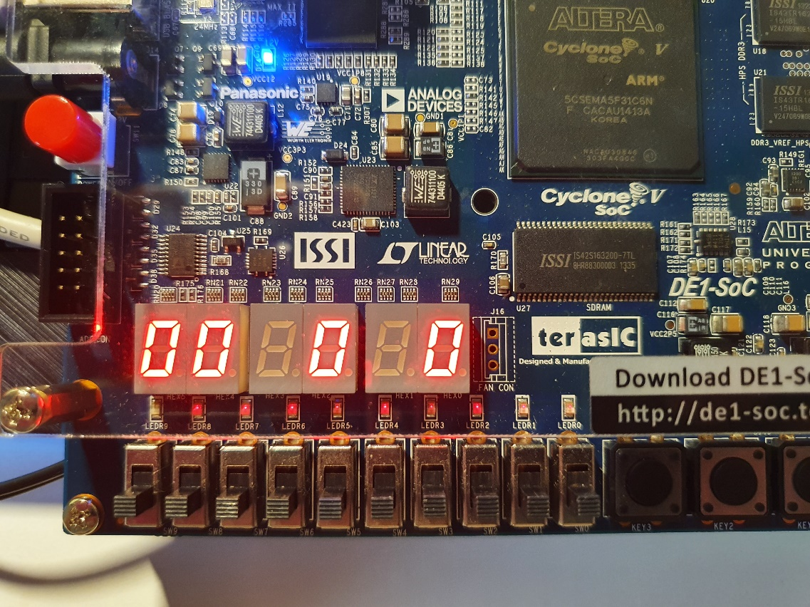
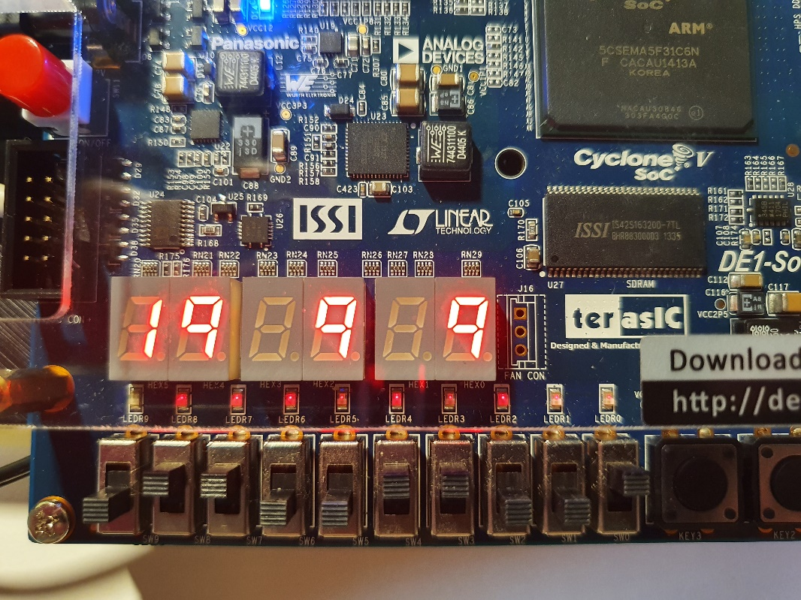
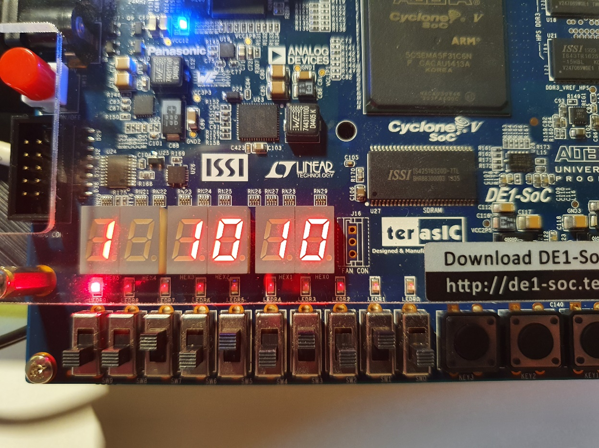
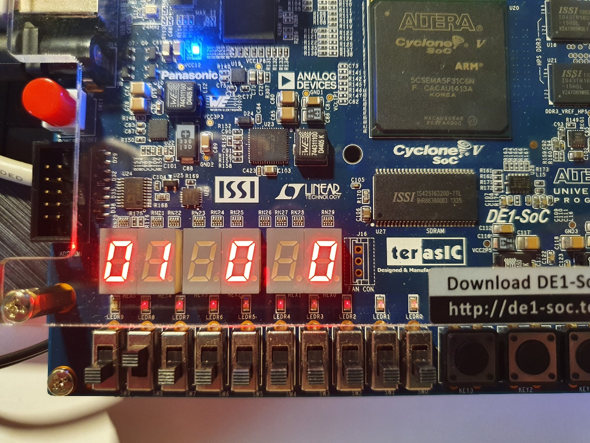
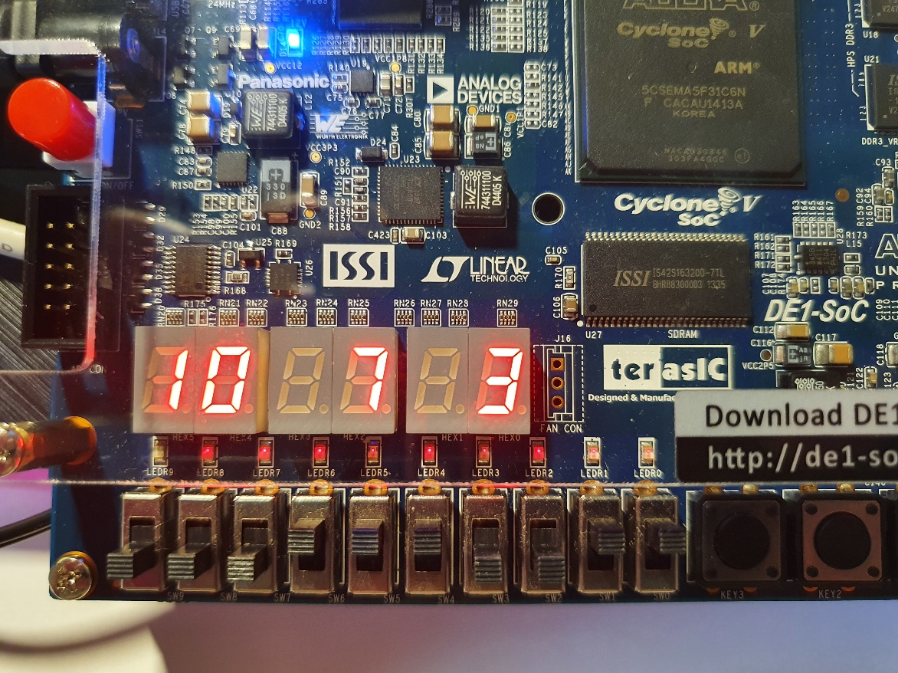
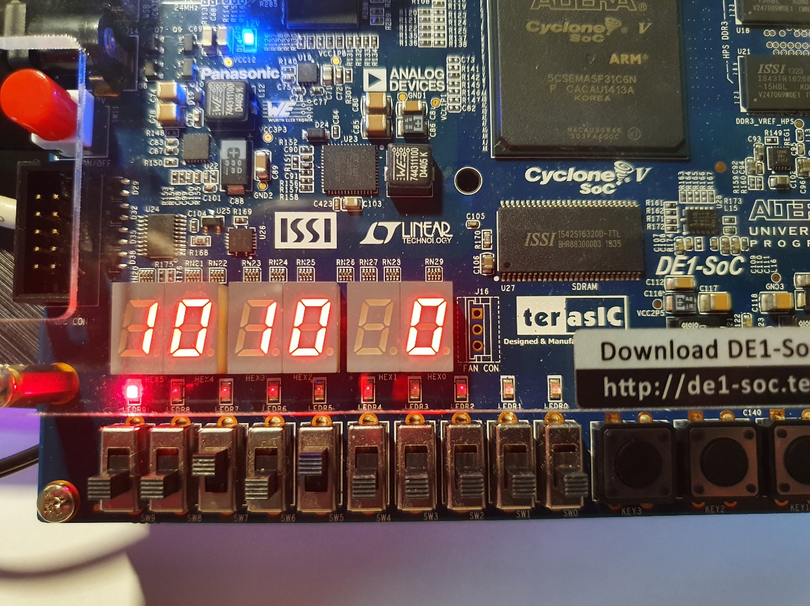
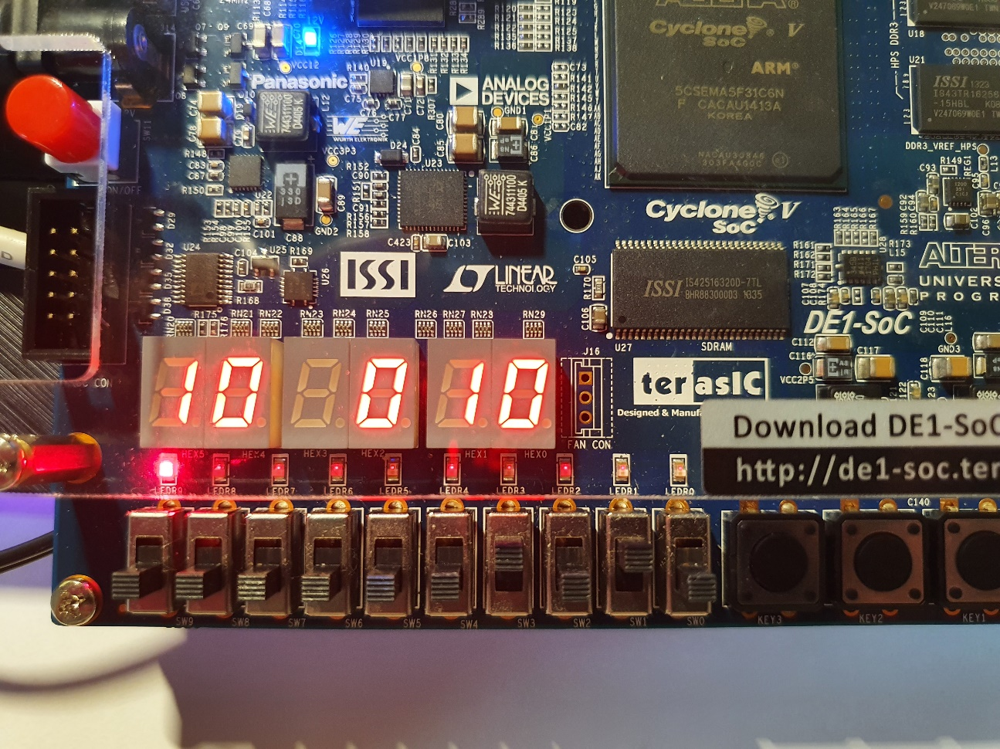
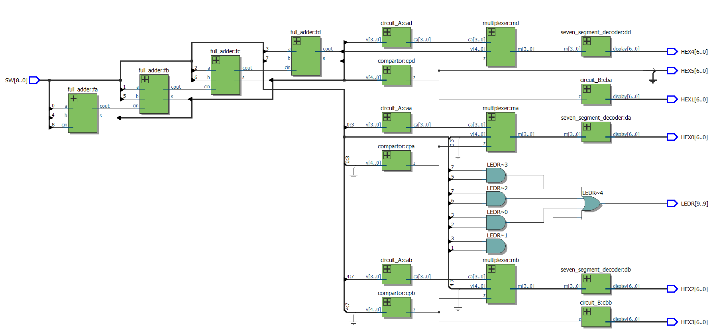

# Lab 1：組合邏輯、BCD 轉換與加法

[回到總覽](../../README.md) · [回到 Lab 索引](../../docs/LABS.md)

## 實驗目的

本實驗以組合邏輯為主，練習多工器、七段顯示器解碼、二進位轉十進位、全加器，以及兩個一位數 BCD 數字的加法。輸入主要來自 DE1-SoC 的滑動開關，結果顯示於紅色 LED 與六組七段顯示器。

## 設計脈絡

BCD 一位數只允許 `0` 到 `9`。兩個 4-bit 數字相加後，若結果大於 9，電路必須進行十進位修正並顯示十位進位。專案把問題拆成全加器、比較器、修正電路、多工器與七段顯示器解碼器。

## 子專案

| 專案 | 主要內容 | 重要模組／檔案 |
| --- | --- | --- |
| [`part07-bcd-adder`](projects/part07-bcd-adder/) | 完整 BCD 加法器，兩個 BCD 輸入加上 carry-in | `lab_1.v` |
| [`part01-multiplexer`](projects/part01-multiplexer/) | 多工器與開關選擇 | `LAB1_1`, `multiplexer` |
| [`part03-multiplexer-hardware`](projects/part03-multiplexer-hardware/) | 多工器應用與硬體驗證 | `LAB1_3`, `multiplexer` |
| [`part04-seven-segment`](projects/part04-seven-segment/) | 4-bit 數字轉七段顯示 | `seven_segment_decoder` |
| [`part05-bcd-correction`](projects/part05-bcd-correction/) | BCD 合法性比較、修正與顯示 | `compartor`, `circuit_A`, `circuit_B` |
| [`part06-full-adder`](projects/part06-full-adder/) | 1-bit full adder | `full_adder` |
| [`archive-registered-stub`](projects/archive-registered-stub/) | 目前只有空的 `registered` 模組 | `registered.v` |

## 頂層 I/O

- `SW[7:4]`、`SW[3:0]`：兩個 4-bit BCD 輸入。
- `SW[8]`：加法 carry-in。
- `HEX0`、`HEX2`：兩個輸入數字。
- `HEX4`、`HEX5`：加法結果的個位與十位。
- `LEDR[9]`：輸入不是合法 BCD 數字時的錯誤提示。

## 關鍵觀念

- 組合邏輯不保存狀態，輸出只由目前輸入決定。
- ripple-carry adder 將前一位的 carry 串接到下一位。
- BCD 加法不能直接把 4-bit 二進位結果當成十進位顯示，結果大於 9 時需要修正。
- DE1-SoC 七段顯示器多為 active-low，位元為 `0` 時對應燈段點亮。

## 實驗內容分析

完整設計先用四級 full adder 計算兩個 4-bit 輸入與 carry-in。`Z0`、`Z1` 用來判斷兩組輸入是否超過 BCD 合法範圍；`Z2` 判斷二進位加法結果是否需要十進位修正。修正網路的目的等價於一般 BCD adder 在結果大於 9 時加上 `6`，使低四位回到合法 BCD 個位並產生十位進位。

`HEX0/HEX1` 與 `HEX2/HEX3` 顯示兩個輸入，`HEX4/HEX5` 顯示結果。這種安排不只證明算術結果，也能同時檢查輸入解碼與錯誤判斷是否一致。

## 實驗結果與解讀

報告記錄顯示，`SW[3:0]` 與 `SW[7:4]` 分別作為兩個輸入，六組七段顯示器可同時呈現兩個輸入與加法結果，非法輸入則由 `LEDR[9]` 指示。

| 測試類型 | 預期結果 | 可驗證內容 |
| --- | --- | --- |
| `3 + 5 + 0` | 顯示 `08` | 不需 BCD 修正的普通加法 |
| `8 + 7 + 0` | 顯示 `15` | 和大於 9 時能修正並進位 |
| `9 + 9 + 1` | 顯示 `19` | 一位 BCD 加法的最大合法結果 |
| 任一輸入為 `A` 到 `F` | 錯誤 LED 亮 | 輸入合法性檢查 |

結果的核心意義是：二進位加法器本身只知道位元運算，不知道十進位位數規則；BCD correction layer 才把二進位和轉成可直接顯示的十進位格式。

## 實機結果與圖集

圖片直接取自原始 Word 報告。零輸入、一般加法、十位進位與非法 BCD 輸入都有實機狀態；RTL Viewer 顯示綜合後的階層。這些是原報告證據，不代表本次整理重新上板量測。

| 零輸入／基準狀態 | 最大合法結果 `9 + 9 + 1 = 19` | 非法 BCD 輸入與錯誤 LED |
| --- | --- | --- |
|  |  |  |

完整原始圖集（7 張實機照片與 1 張 RTL Viewer）

## 用途與延伸

- 電子計算機、數位電表與十進位計數器。
- 時鐘、計時器與任何以 BCD 保存數字的顯示系統。
- 更大位數的 BCD adder，可把每一位的 decimal carry 串到下一位。
- 將手寫七段解碼器抽成共用模組，可減少重複邏輯。

## 限制與改進

- 原始碼大量使用 implicit wire，建議加入 ``default_nettype none`` 以提早發現拼字錯誤。
- 組合式 ripple carry 的延遲會隨位數增加；多位 BCD 可考慮分段或 pipeline。
- `projects/archive-registered-stub/registered.v` 不是完整 Part 7，正式展示應以 `projects/part07-bcd-adder/lab_1.v` 為主要實作。

## 驗證方式

1. 分別輸入合法 BCD 值，例如 `3 + 5`、`8 + 7`、`9 + 9 + 1`。
2. 確認七段顯示器顯示 `8`、`15`、`19`。
3. 輸入 `1010` 到 `1111`，確認錯誤 LED 反應。
4. 對照本頁 `assets/` 中由原始報告擷取的實機照片。

## 檔案入口

- [完整實作](projects/part07-bcd-adder/lab_1.v)
- [Quartus 專案](projects/part07-bcd-adder/lab_1.qpf)

## 已知狀況

報告中的 Part 7 是 BCD 加法，但 `projects/archive-registered-stub/registered.v` 目前只有空模組；實際完整 BCD 加法程式位於 `projects/part07-bcd-adder/lab_1.v`。這項說明用來避免讀者誤把歷史殘留資料視為完整答案。

`Part 01` 已於 2026-09-25 使用 Quartus Prime 25.1 Standard 在純 ASCII 暫存路徑完成 full compilation，結果為 `0 errors, 248 warnings`。警告包含未使用的 DE1-SoC 腳位、固定輸出與缺少 SDC；這是單一代表工程的工具相容性檢查，不等同於全部 Part 或 timing 已通過。
