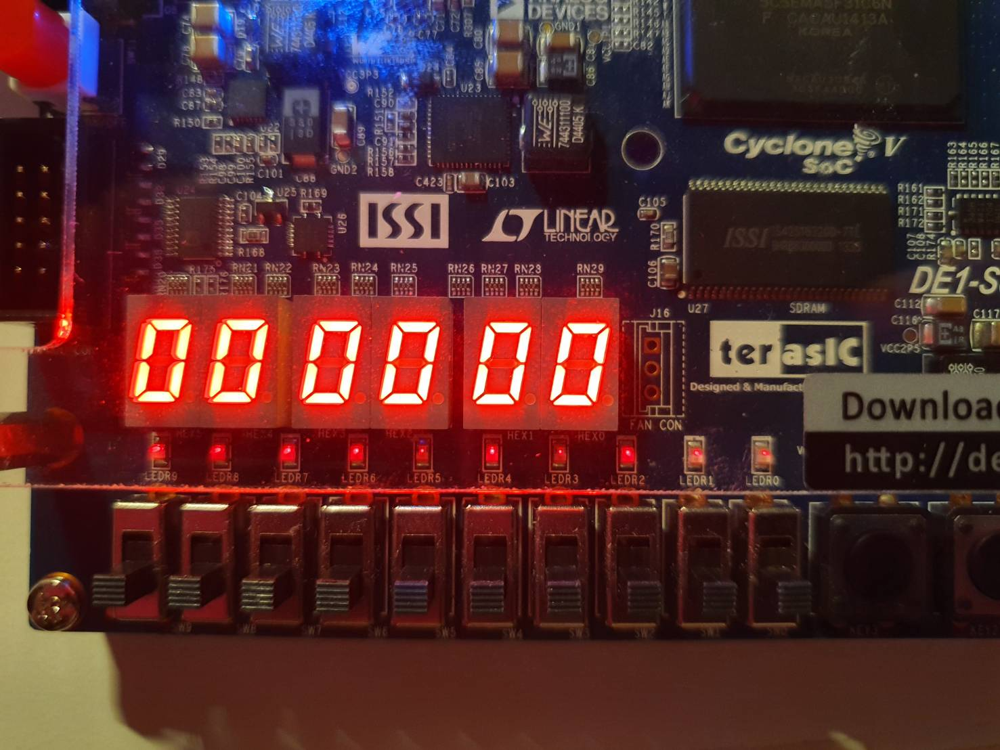
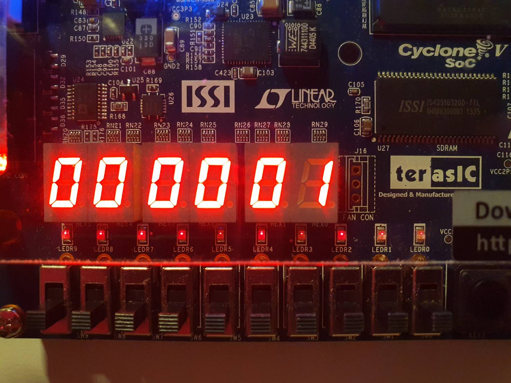
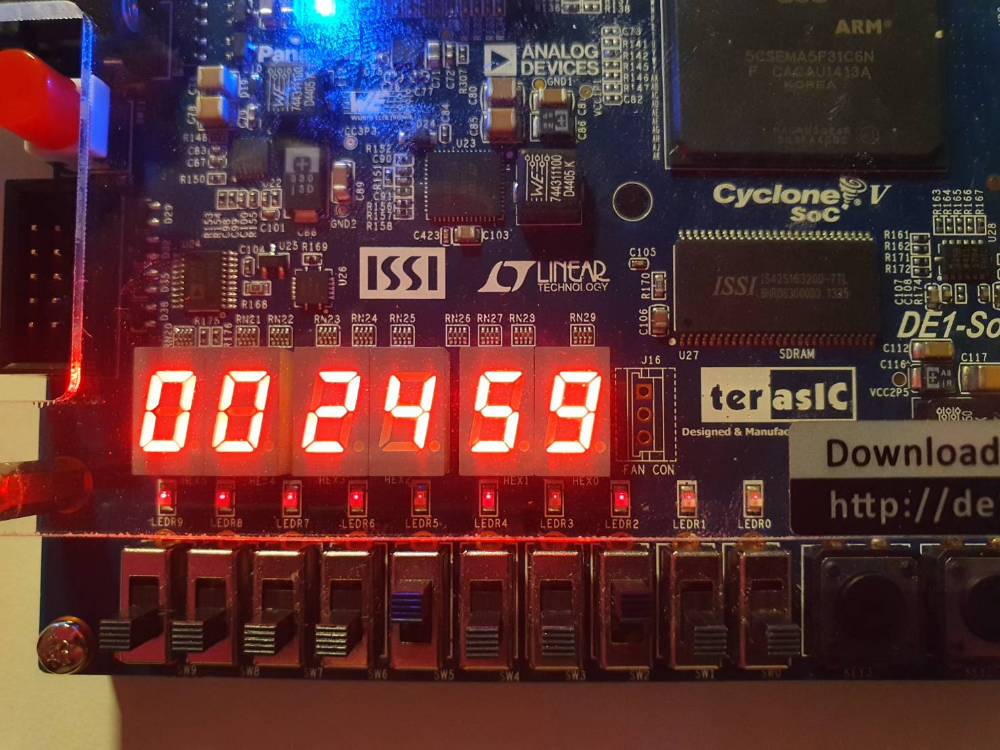
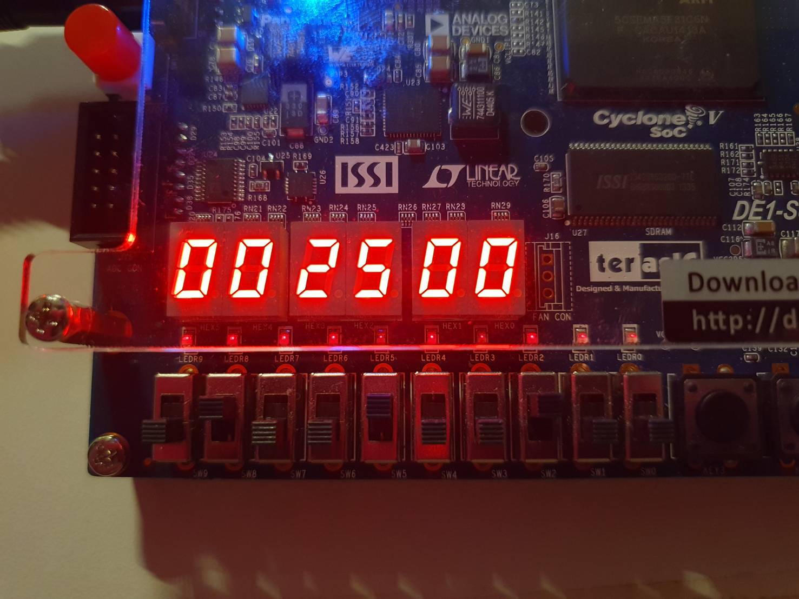
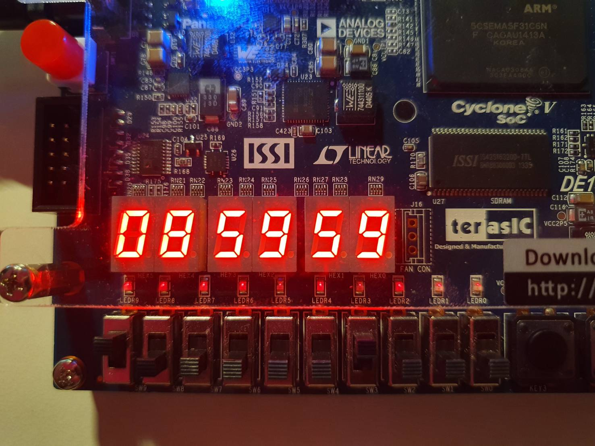
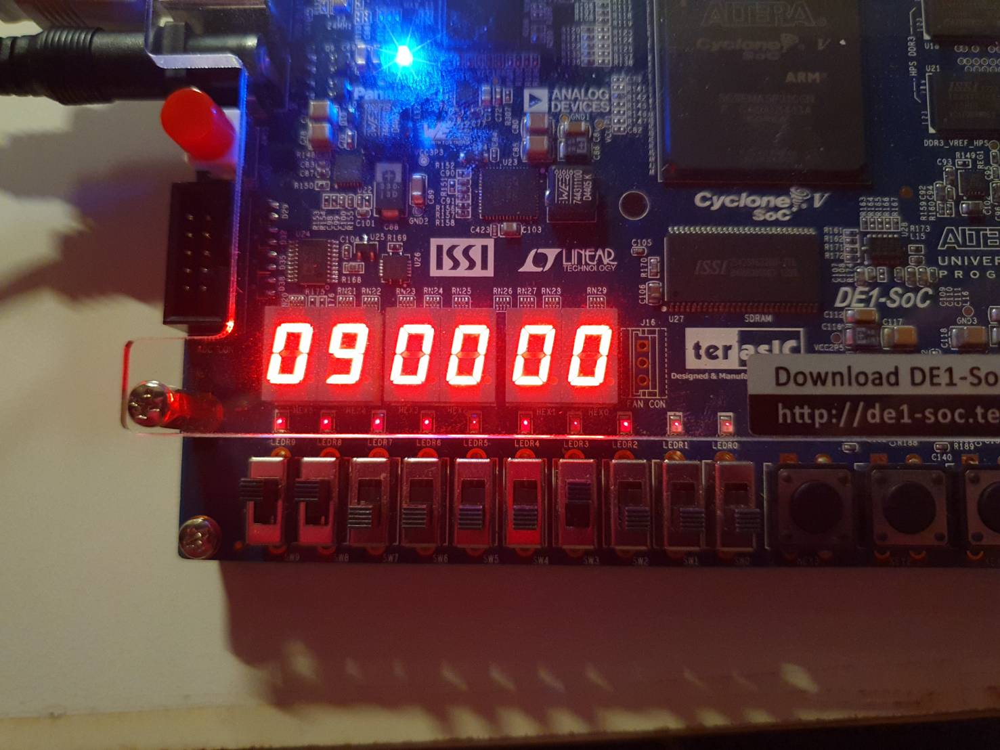
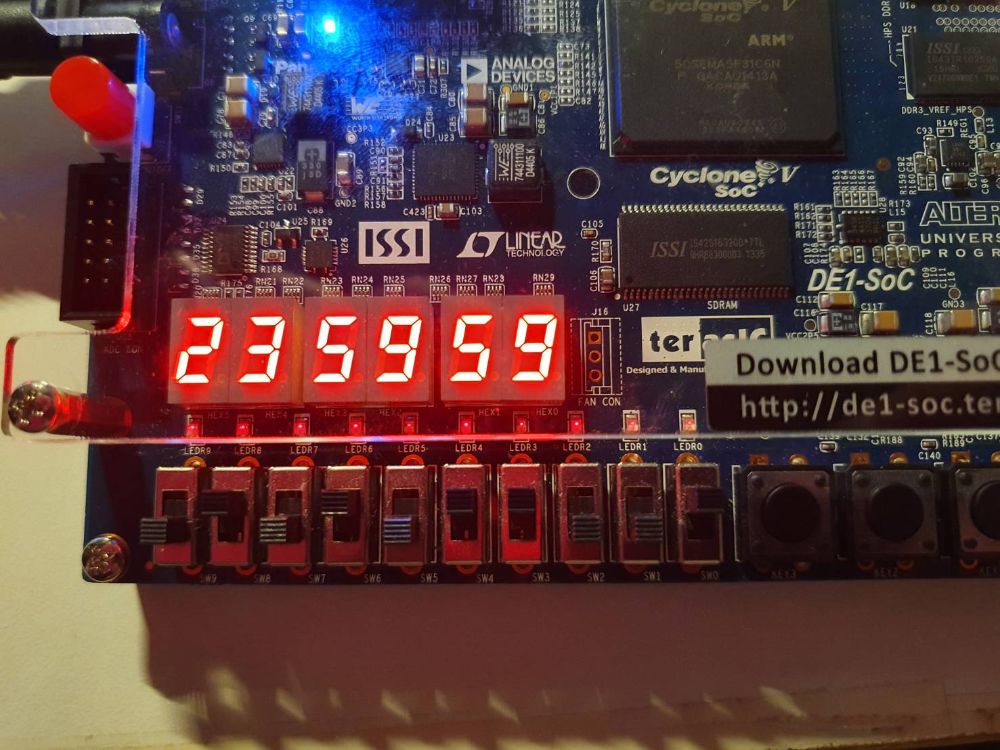
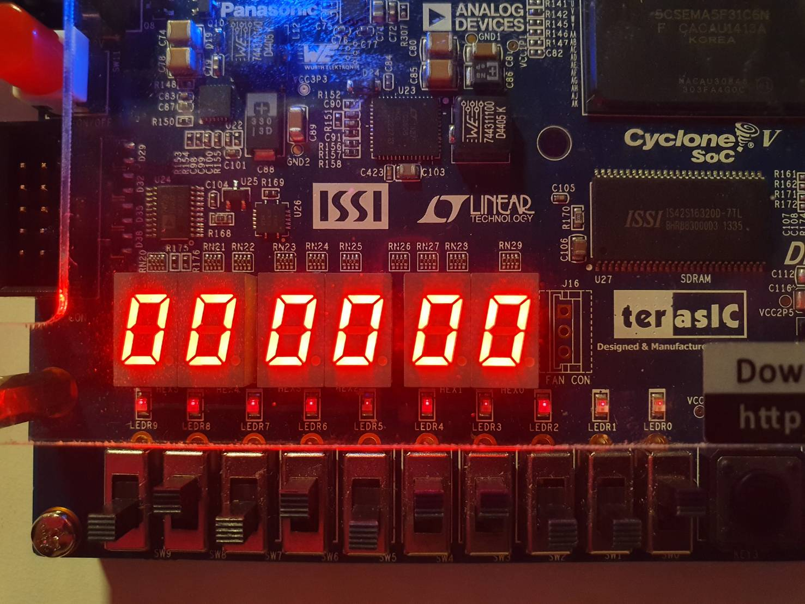
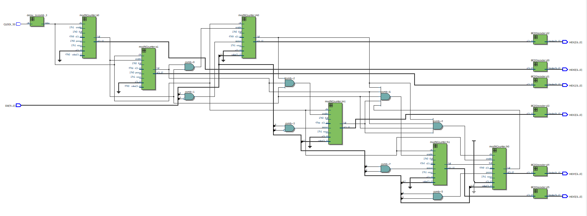

# Lab 2：正反器、計數器與即時時鐘

[回到總覽](../../README.md) · [回到 Lab 索引](../../docs/LABS.md)

## 實驗目的

本實驗由 latch 與 flip-flop 開始，逐步建立 T flip-flop、16-bit counter、LPM counter、十進位／模 N 計數器，最後完成六位數 time-of-day clock。重點是同步時序電路、enable/carry 串接與除頻。

## 子專案

| 專案 | 主要內容 | 重要模組／檔案 |
| --- | --- | --- |
| [`part01-latches-flipflops`](projects/part01-latches-flipflops/) | 比較 D latch、正緣與負緣 D flip-flop | `D_latch`, `pos_flipflop`, `neg_flipflop`, `.vwf` 波形 |
| [`part02-t-flipflop`](projects/part02-t-flipflop/) | T flip-flop 計數器 | `T_flipflop`, `seven_segment_decoder` |
| [`part03-counter`](projects/part03-counter/) | 16-bit T flip-flop counter | `T_flipflop_16bit` |
| [`part04-lpm-counter`](projects/part04-lpm-counter/) | Quartus LPM counter 與 BDF 整合 | `counter.v`, `counter.qip`, `lab2_4.bdf` |
| [`part05-decimal-counter`](projects/part05-decimal-counter/) | 1 Hz 十進位計數器 | `delay_1s`, `tenCounter` |
| [`part06-modulo-counter`](projects/part06-modulo-counter/) | 可串接的模 N 計數器 | `modNCounter`, `BCDDecoder` |
| [`part07-time-of-day-clock`](projects/part07-time-of-day-clock/) | 時、分、秒即時時鐘 | `Counter`, `compare_full`, `delay_1s` |

## 最終設計架構

`CLOCK_50` 先經 `delay_1s` 除頻成約 1 Hz。六個 BCD counter 依序代表秒個位、秒十位、分個位、分十位、時個位、時十位；每級到達上限後用 `full` 啟用下一級。六個結果分別送到 `HEX0` 至 `HEX5`。

## Lab 2-7 I/O

- `CLOCK_50`：板載 50 MHz clock。
- `SW[7:0]`：時間設定值。
- `SW[8]`、`SW[9]`：選擇設定分鐘或小時。
- `HEX0..HEX5`：秒、分、時的六位 BCD 顯示。

## 關鍵觀念

- latch 是 level-sensitive，flip-flop 是 edge-triggered。
- T flip-flop 在 `T=1` 時於有效時脈邊緣翻轉。
- 除頻計數必須根據實際輸入時脈設定；50 MHz 產生 1 Hz 需要計滿約 50,000,000 個週期。
- 多位數計數器應以 enable/carry 串接，避免手動產生多個非同步 clock。

## 實驗內容分析

最終電路使用六個 `Counter` instance。秒個位模 10、秒十位模 6；分鐘欄位採相同結構。小時十位計到 2 時，個位的有效上限改為 3，使 `23` 之後回到 `00`。`full` 訊號只有在低位數到達上限時才推動下一位，因此能形成 BCD carry chain。

時間設定不是只看開關電位，而是由 `preset_d` 偵測 preset 的 `0 -> 1` 邊緣。這可避免使用者把設定開關維持在高電位時，每秒都重複覆寫目前時間。

## 報告結果與解讀

| 報告測試 | 觀察結果 | 分析目的 |
| --- | --- | --- |
| Configuration 後啟動 | 從 `00:00:00` 開始 | 檢查初始狀態與所有 BCD 位數 |
| `00:24:59` | 下一秒為 `00:25:00` | 檢查秒 carry 到分鐘 |
| `08:59:59` | 下一秒為 `09:00:00` | 檢查分鐘 carry 到小時個位 |
| `23:59:59` | 下一秒為 `00:00:00` | 檢查 24 小時制回捲 |
| 設定開關保持 High | 不持續覆寫 | 檢查 rising-edge preset 設計 |

這些測試覆蓋一般進位、跨欄位進位與每日最大邊界，比只觀察連續計數更能證明時鐘狀態轉移正確。

## 實機結果與圖集

報告以成對照片保存最後一秒與 carry 後的下一秒。這組證據直接涵蓋秒、分、時與 24 小時回捲，不只顯示任意一個時間點。

| 測試 | 邊界前 | 邊界後 |
| --- | --- | --- |
| 啟動計數 |  |  |
| 分鐘進位 |  |  |
| 小時進位 |  |  |
| 24 小時回捲 |  |  |

## 用途與延伸

- 數位時鐘、倒數計時器、碼表與反應時間測量。
- 將固定模數改為 parameter，可重用於不同進位制。
- 加入 alarm、pause、秒歸零與按鍵去彈跳。
- 以 clock enable 取代衍生 clock，可改善 timing constraint 與 clock-domain 分析。

## 限制與改進

- `Counter` 內的 reset 被固定成 `1'b1`，不是實際外部 reset；暫存器初值依賴 FPGA power-up 行為。
- `delay_1s` 產生窄 pulse 後被當成 clock 使用。較穩健的做法是全系統維持 `CLOCK_50`，把 1 Hz pulse 當作 enable。
- `count`、`delay`、`preset_d` 沒有明確 reset，模擬初期可能出現 `X`。
- 機械開關可能彈跳；實際產品需 synchronizer 與 debounce。

## 驗證方式

1. 使用 `projects/part01-latches-flipflops` 的 `.vwf` 比較 latch、正緣 FF、負緣 FF 波形。
2. 測試十進位 counter 是否由 9 回到 0。
3. 測試秒數 `59 -> 00` 時分鐘是否加一。
4. 測試分鐘 `59 -> 00` 與小時邊界。
5. 檢查時間設定開關是否只修改指定欄位。

## 檔案入口

- [最終時鐘實作](projects/part07-time-of-day-clock/lab2_7.v)
- [波形範例](projects/part01-latches-flipflops/Lab2_1.vwf)

> Repository 保留原始 `.vwf` 測試向量，但 Word 報告沒有內嵌模擬波形截圖；目前展示的是報告中的實機照片與 RTL Viewer。若要把波形列為新版驗證結果，仍須在相容的 Quartus／模擬器環境重新執行並保存輸出。
