# Lab 3：加減法器與乘法器

[回到總覽](../../README.md) · [回到 Lab 索引](../../docs/LABS.md)

## 實驗目的

本實驗實作加法、減法與乘法電路，並比較手寫 Verilog 與 Altera LPM 元件的結構和效能。設計從 ripple-carry adder 延伸到 8-bit registered adder、陣列式乘法器，以及兩組 8-bit 乘積相加的 16-bit datapath。

## 子專案

| 專案 | 主要內容 | 重要模組 |
| --- | --- | --- |
| [`part01-ripple-carry-adder`](projects/part01-ripple-carry-adder/) | 8-bit ripple-carry adder 與輸入暫存 | `ripple_carry_adder`, `eight_bit_ripple_carry_adder`, `D_flipflop` |
| [`part02-registered-adder`](projects/part02-registered-adder/) | 8-bit 加減法器與 registered input | `eight_bit_adds`, `eight_bit_registered` |
| [`part04-four-bit-multiplier`](projects/part04-four-bit-multiplier/) | 4 x 4-bit 組合式乘法 | `MutiplierUnit`, `four_bit_adds` |
| [`part05-multiplier-unit`](projects/part05-multiplier-unit/) | 8-bit 部分積與加法 | `MutiplierUnit`, `eight_bit_adds` |
| [`part06-eight-bit-multiplier`](projects/part06-eight-bit-multiplier/) | `(A × B) + (C × D)`，16-bit 結果 | `eight_bit_Mulitiplier`, `_16_bit_add`, `Change_display` |

## 最終設計資料流

`SW[7:0]` 提供資料；`KEY` 與控制開關把資料分別寫入 A、B、C、D 四個 8-bit register。兩個乘法器平行計算 `A × B` 與 `C × D`，16-bit adder 再將兩個乘積相加。四組七段顯示器用十六進位顯示選定的暫存器、乘積或總和。

## 關鍵觀念

- ripple-carry adder 結構簡單，但 carry 必須逐位傳遞，位數增加時 critical path 也會增加。
- 減法可利用二補數轉成 `A + ~B + 1`。
- 乘法器可由部分積與多級加法器構成。
- 暫存輸入能把操作拆成多個時脈步驟，形成簡單 datapath。
- `carry_out` 與 signed overflow 是不同概念，驗證時應分開處理。

## 實驗內容分析

`SW[7:0]` 是共用資料輸入；`SW[9]` 是 write enable，`SW[8]` 選擇 AB 或 CD 群組，`KEY[2]` 再選擇群組內的第一或第二個 register。資料在 `KEY[1]` 的負緣寫入 A、B、C 或 D。兩個組合式乘法器持續產生 `AB`、`CD`，16-bit adder 計算兩者總和。

`KEY[3]` 控制顯示模式：選擇顯示 16-bit 結果，或顯示 `{A,B}`／`{C,D}`。因此同一組四位七段顯示器可用來檢查輸入是否正確寫入，也能顯示最終乘加結果。

同課程的參考實作另外採用 `lpm_add` 與 `lpm_mult` 類型的 Altera IP。這和本地專案的手寫 partial-product/ripple-carry 版本形成對照：前者讓工具映射到合適的 FPGA arithmetic/DSP resource，後者較能直接觀察硬體結構與 carry path。

## 報告結果與解讀

| 操作 | 報告觀察 | 解讀 |
| --- | --- | --- |
| `SW9=0` 時嘗試寫入 | 暫存器不變 | write enable gating 正常 |
| 將 `FF` 寫入 A、D，B/C 為 0 | 結果為 `0000` | `(FF × 0) + (0 × FF) = 0` |
| 再將 `FF` 寫入 C，D 已為 `FF` | 結果為 `FE01` | `0xFF × 0xFF = 65025 = 0xFE01` |

`FE01` 是很有代表性的邊界測試，因為它同時驗證八個 partial product、各級 carry，以及完整 16-bit 乘積位寬。若四個輸入都為 `FF`，數學結果為 `0x1FC02`；目前輸出只有 16-bit，因此顯示低 16 位 `FC02`，並由 `LEDR[9]` 的 carry 表示超出範圍。

## 實機結果與圖集

十二張照片記錄零值、`0xFF`、全 `1`、進位與不同輸入暫存器組合的七段顯示結果。照片可確認當時的 display path 與按鍵／開關操作；若要完整證明算術正確性，仍需 testbench 自動比對 `(A × B) + (C × D)`。

| 零值基準 | `0xFF` 邊界 pattern | `0xFF × 0xFF = 0xFE01` |
| --- | --- | --- |
| 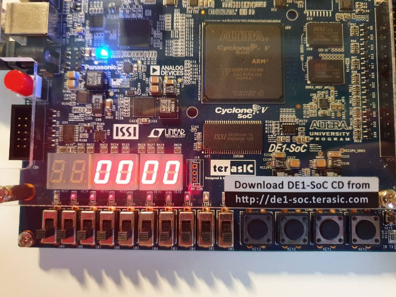 | 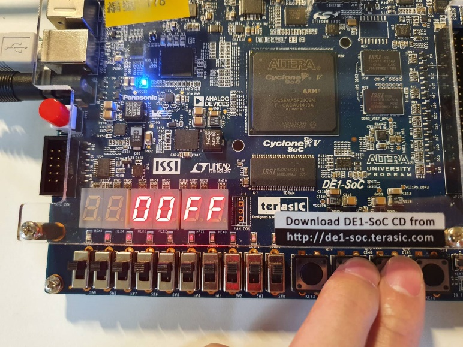 | 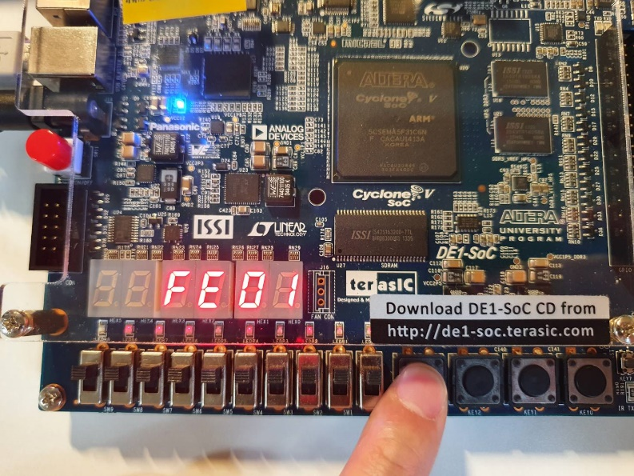 |

完整原始圖集（12 張實機照片與 1 張 RTL Viewer）

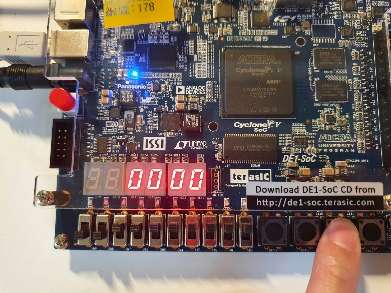
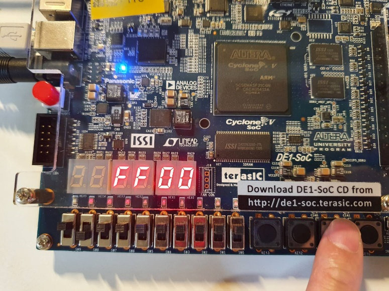
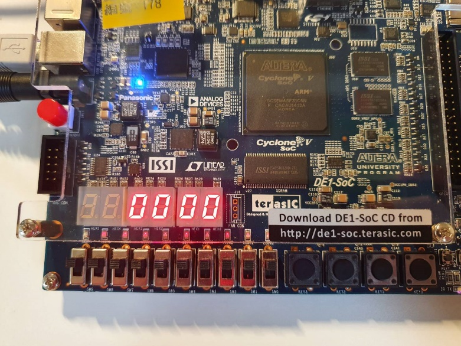

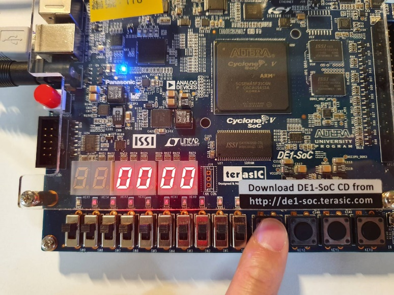
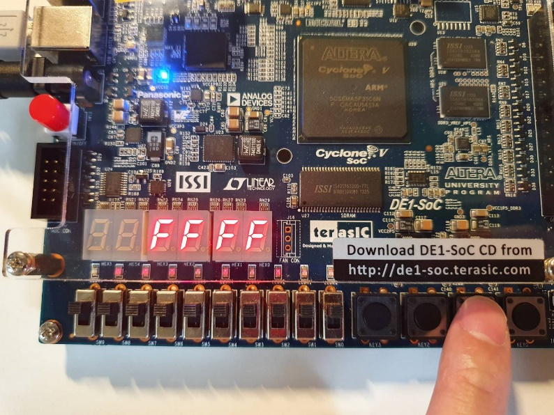

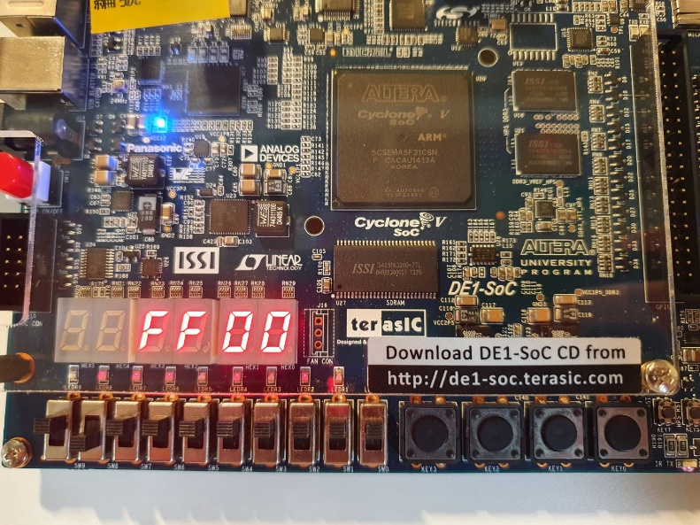
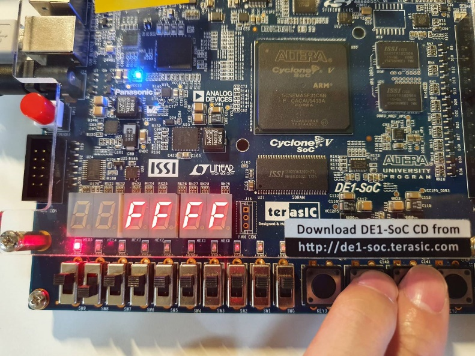
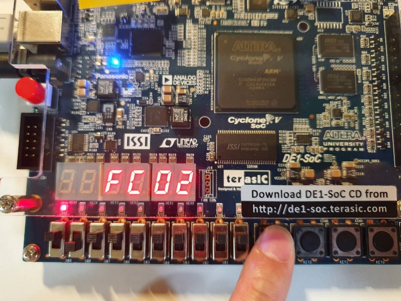
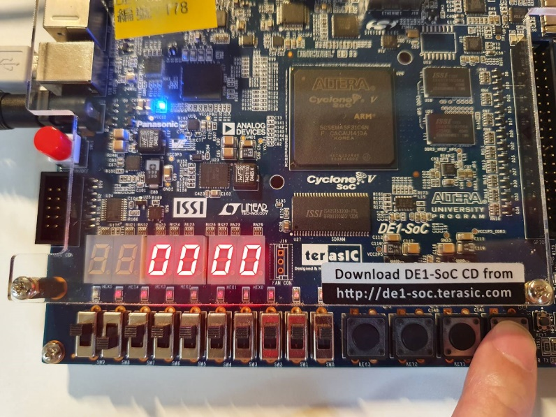
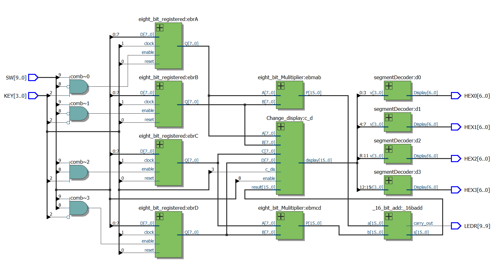

## 用途與延伸

- 數位訊號處理中的 multiply-accumulate（MAC）。
- FIR filter、影像卷積、矩陣乘法與座標轉換。
- 比較邏輯閘組成的 multiplier 與 FPGA DSP block/LPM 的面積和速度。
- 加入 pipeline registers，提高最大時脈頻率與吞吐量。

## 限制與改進

- 目前 multiplier 是純組合式多級加法，critical path 較長。
- `segmentDecoder` 使用沒有 sensitivity list 的 `always begin`，模擬可能形成零時間無限迴圈；應改成 `always @(*)` 或 `always_comb`。
- `Change_display` 的組合邏輯使用 nonblocking assignment，建議改用 blocking assignment。
- 模組名稱中的 `Mutiplier`／`Mulitiplier` 拼字不一致，重構時應一併更新所有 instance。

## 驗證方式

1. 測試加法邊界：`0x00 + 0x00`、`0xFF + 0x01`。
2. 測試減法與借位情況。
3. 測試乘法：`0 × N`、`1 × N`、`0xFF × 0xFF`。
4. 對最終式 `(A × B) + (C × D)` 用手算或軟體結果比對。
5. 在 Quartus Timing Analyzer 比較 ripple-carry 與 LPM 實作的延遲。

## 檔案入口

- [8-bit 加減法器](projects/part02-registered-adder/lab3_2.v)
- [最終乘加設計](projects/part06-eight-bit-multiplier/lab3_6.v)

## 命名備註

原始碼中的 `Mutiplier`、`Mulitiplier` 等拼字沿用原專案，以免修改模組名稱後影響 Quartus 工程。文件統一使用 multiplier 描述功能。
