# Lab 4：暫存器、移位器與有限狀態機

[回到總覽](../../README.md) · [回到 Lab 索引](../../docs/LABS.md)

## 實驗目的

本實驗練習有限狀態機（FSM），包含基本暫存器、序列偵測、移位暫存器與十狀態 counter-like circuit。設計重點是把 next-state combinational logic、state register 與 output logic 分開理解。

## 子專案

| 專案 | 主要內容 | 重要模組 |
| --- | --- | --- |
| [`part01-register`](projects/part01-register/) | enable-controlled register | `register` |
| [`part02-sequence-detector`](projects/part02-sequence-detector/) | 九狀態序列偵測器 | state table、state FF |
| [`part03-shift-register`](projects/part03-shift-register/) | 4-bit shift register | `rShift` |
| [`part04-ten-state-fsm`](projects/part04-ten-state-fsm/) | 十狀態雙向／保持式 counter-like FSM | `change_state`, `stateTable`, `segment_Decoder` |

## LAB4_2 狀態機

輸入 `w` 決定狀態往連續 0 或連續 1 的路徑前進。到達狀態 E 或 I 時，`LEDR[9]` 的輸出 `z` 變為 1，可用來表示偵測到指定長度的連續輸入。

## LAB4_4 狀態機

FSM 使用 A 到 J 共十個狀態，`SW[2:1]` 控制狀態保持、遞增或遞減，`KEY[0]` 提供 clock，`SW[0]` 為 active-low reset。當前狀態經七段解碼後顯示在 `HEX0`。

## 關鍵觀念

- State register 應只在有效時脈邊緣更新。
- Next-state logic 必須對所有狀態與輸入組合給出結果，避免推導 latch。
- Reset 極性必須和板上按鍵／開關行為一致。
- Moore machine 的輸出只依賴 state；Mealy machine 的輸出同時依賴 state 和 input。

## 實驗內容分析

LAB4_4 用 A 到 J 對應數字 0 到 9。`stateTable` 完整定義四種操作，因此這個 FSM 實際上是一個可保持、加一、加二與減一的模 10 狀態計數器。

| `SW[2:1]` | 狀態動作 | 例子 |
| --- | --- | --- |
| `00` | 保持 | `4 -> 4` |
| `01` | 加 1 | `9 -> 0` |
| `10` | 加 2 | `8 -> 0`, `9 -> 1` |
| `11` | 減 1 | `0 -> 9` |

這裡用 FSM 而非算術 `state + 1` 的教學目的，是練習明確列出每個狀態在各輸入條件下的 next state。對複雜控制器而言，狀態名稱通常代表工作階段，而不只是數字。

## 報告結果與解讀

報告照片記錄了 `w1w0=00` 時顯示值保持不變，以及 `w1w0=01` 時依序顯示 `1,2,...,9,0`。由 source 的 transition table 也可確認 `10` 每次跨兩個狀態、`11` 反向一個狀態。

結果證明三個部分一致工作：state register 能保存目前值、next-state logic 能依輸入選擇轉移、七段解碼器能把 state 顯示成數字。只驗證顯示遞增不足以覆蓋整張 state table，因此 GitHub 文件也列出四種模式作為完整測試集合。

## 實機結果與圖集

照片按操作順序留下三組狀態序列。`result-01`～`result-06` 顯示一般遞增；`result-07`～`result-12` 顯示 `0,2,4,6,8,0` 的加二與回捲；`result-13`～`result-18` 顯示 `0,9,8,7,6,5` 的反向遞減。這些序列直接覆蓋三種轉移模式；保持模式應另由連續按鍵前後狀態不變確認。

| 加一序列 | 加二並回捲 | 減一序列 |
| --- | --- | --- |
| 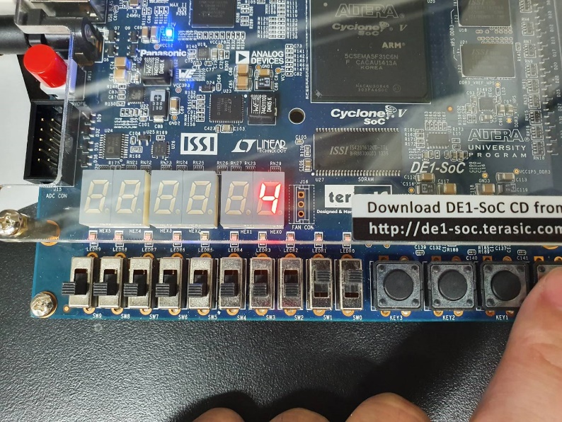 |  | 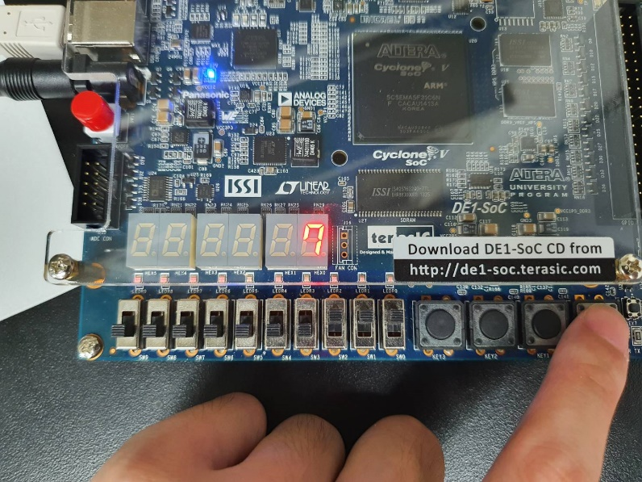 |

完整原始圖集（18 張實機照片與 1 張 RTL Viewer）

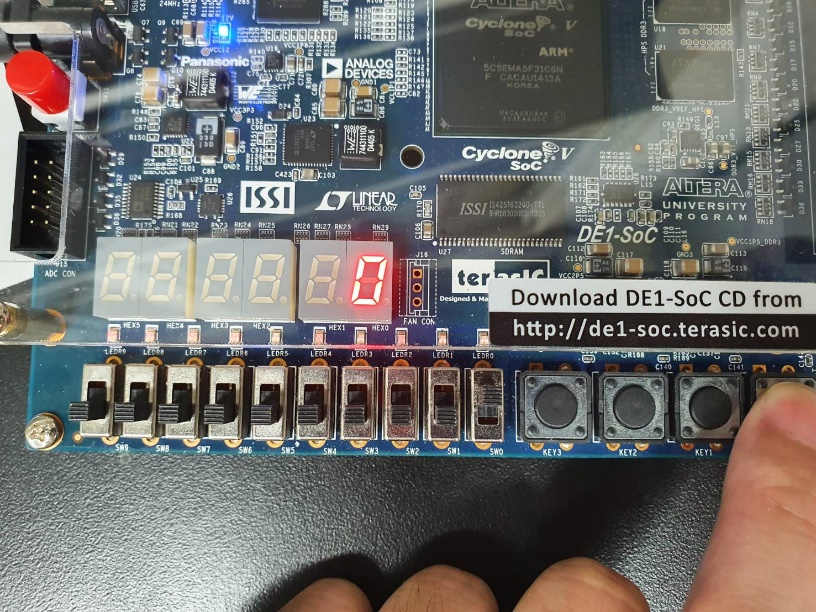
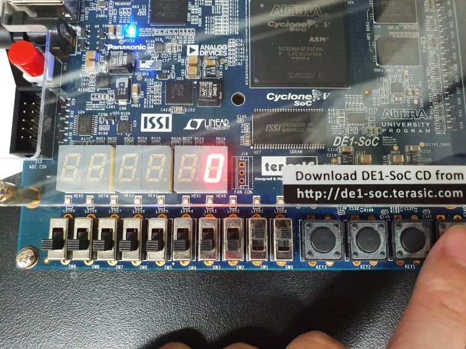
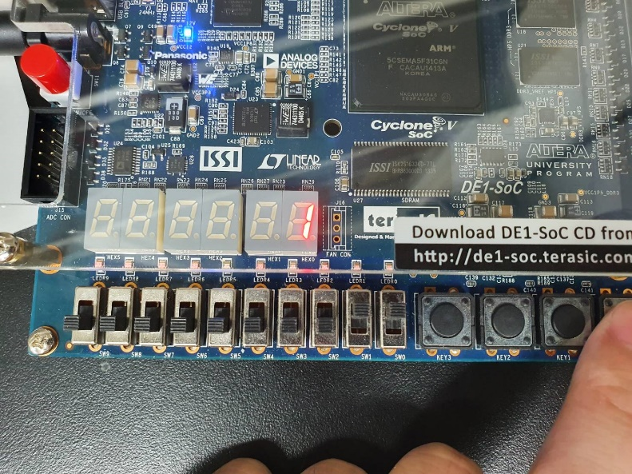
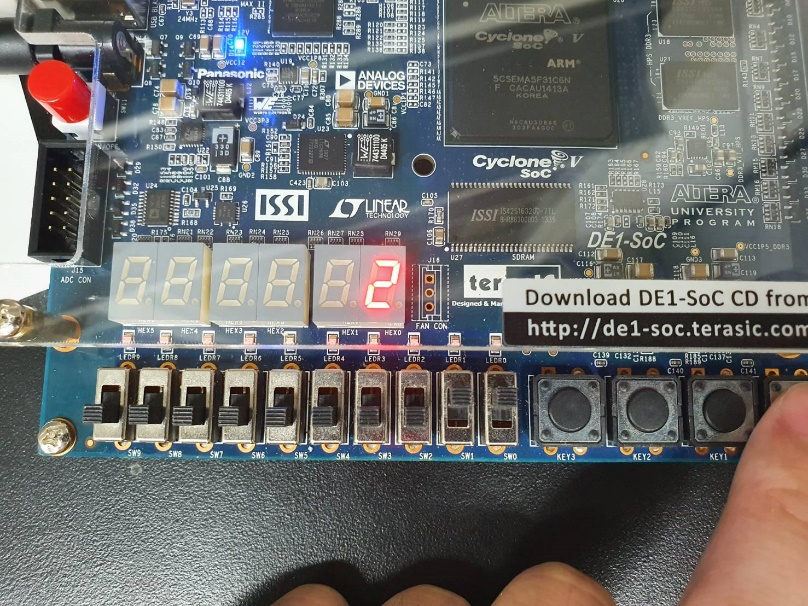
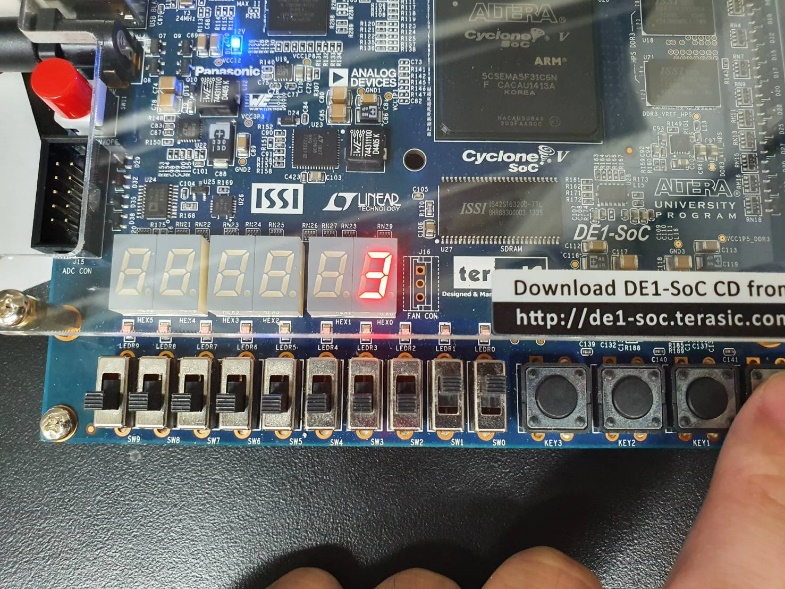

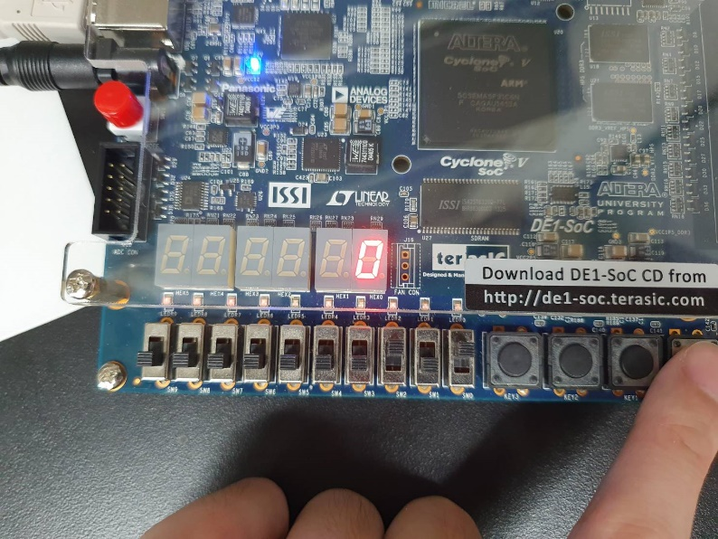
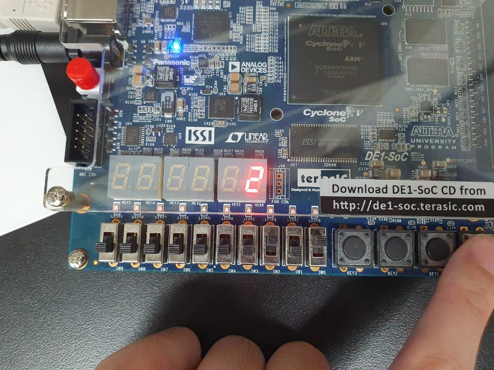
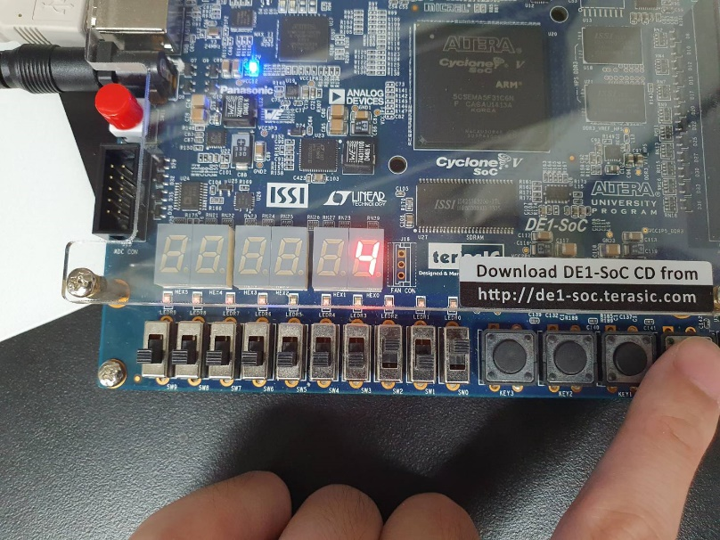

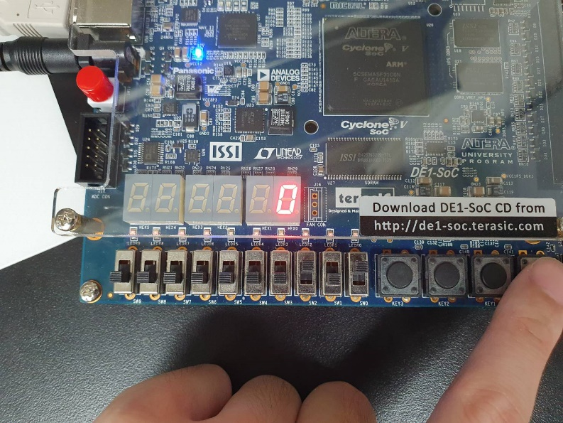
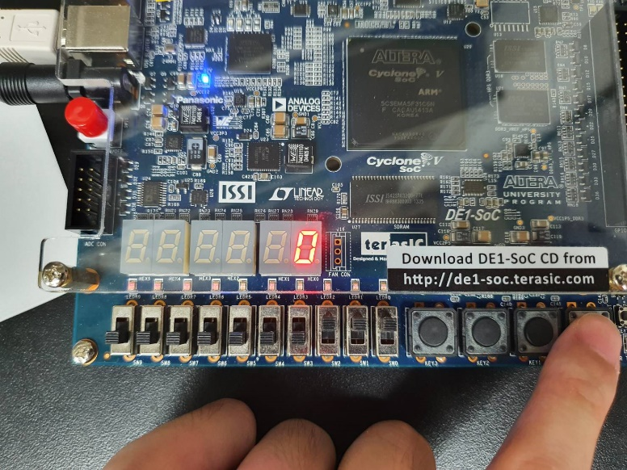
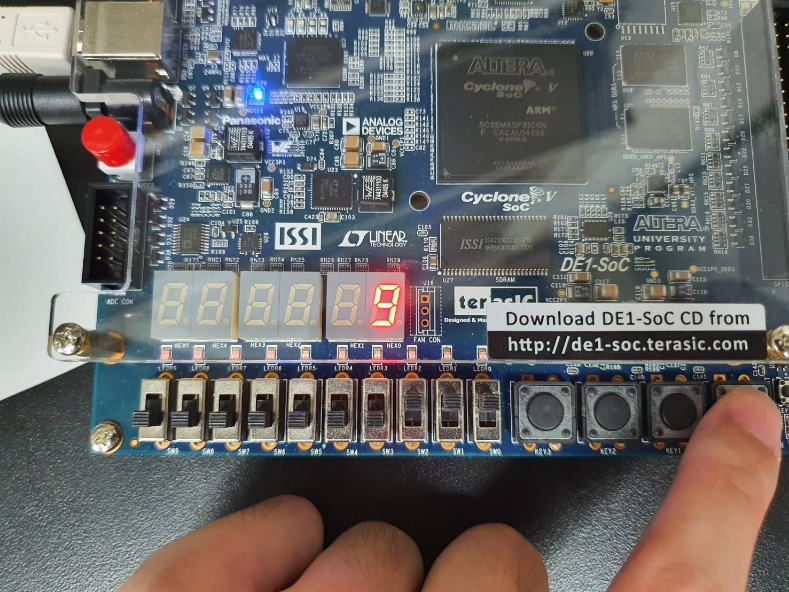
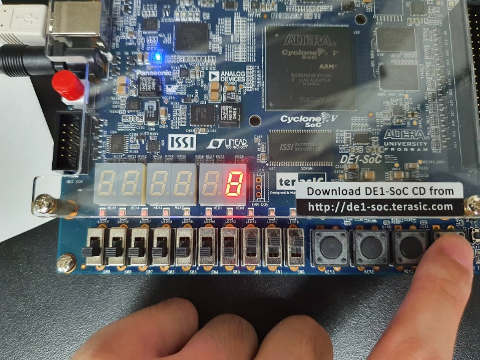

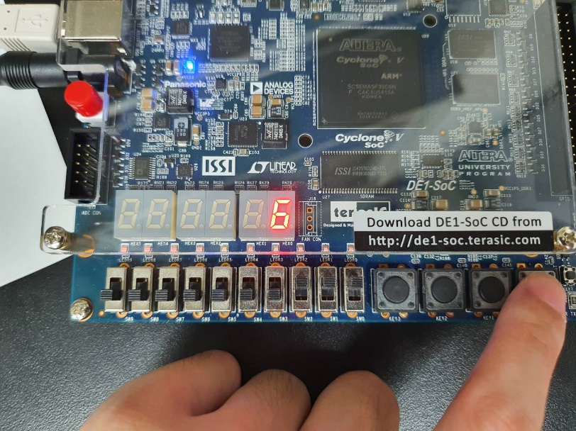

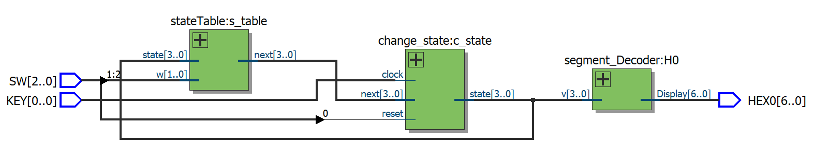

## 用途與延伸

- 交通號誌、販賣機、電梯、通訊協定與按鍵操作流程。
- Sequence detector 可用於封包標頭、密碼序列與事件偵測。
- 加入 timer 可形成「狀態 + 時間」控制器。
- 狀態較多時可改用 enum/SystemVerilog，提高可讀性與除錯能力。

## 限制與改進

- `KEY[0]` 是機械按鍵，未 debounce 時一次按壓可能造成多次狀態跳轉。
- `default: next=4'bxxxx` 適合暴露模擬錯誤，但硬體容錯較差；可改為回到安全狀態 A。
- Reset 是同步 active-low；只有 clock edge 到來時才會復位。
- `segment_Decoder` 同樣應把 `always begin` 改成 `always @(*)`。

## 驗證方式

1. Reset 後確認狀態回到 A／0。
2. 對 LAB4_2 輸入連續 0、連續 1 與交錯序列，觀察 `z`。
3. 對 LAB4_3 逐位送入 0/1，確認 shift 順序。
4. 對 LAB4_4 測試保持、正向、反向，以及 0/9 邊界。

## 檔案入口

- [序列偵測 FSM](projects/part02-sequence-detector/LAB4_2.v)
- [移位暫存器](projects/part03-shift-register/lab4_3.v)
- [十狀態 FSM](projects/part04-ten-state-fsm/lab4_4.v)
