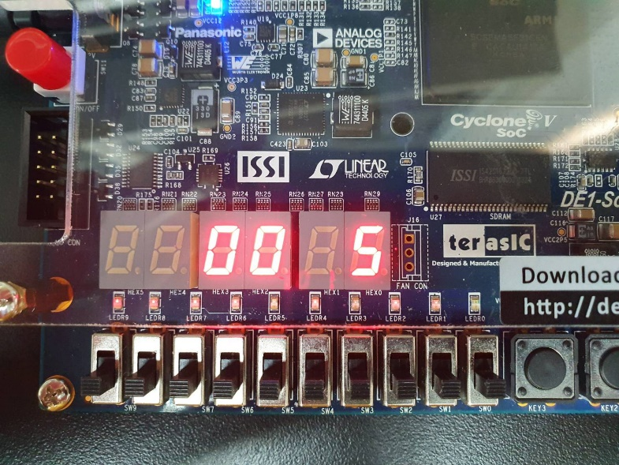
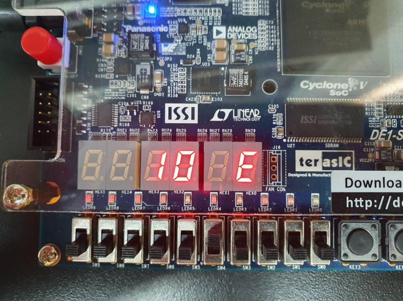
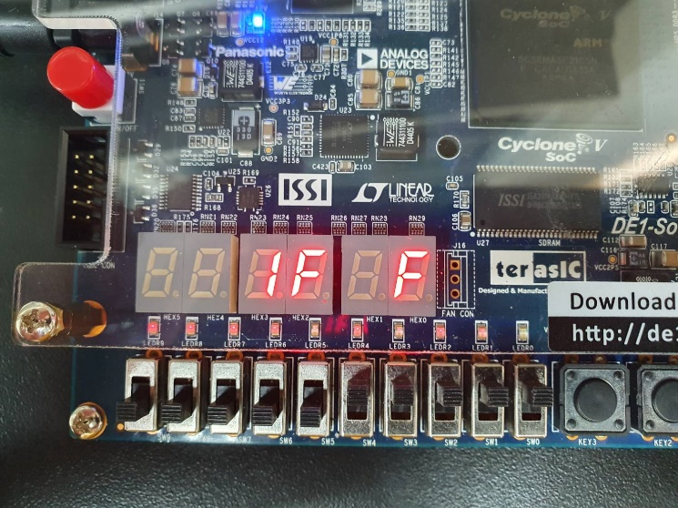
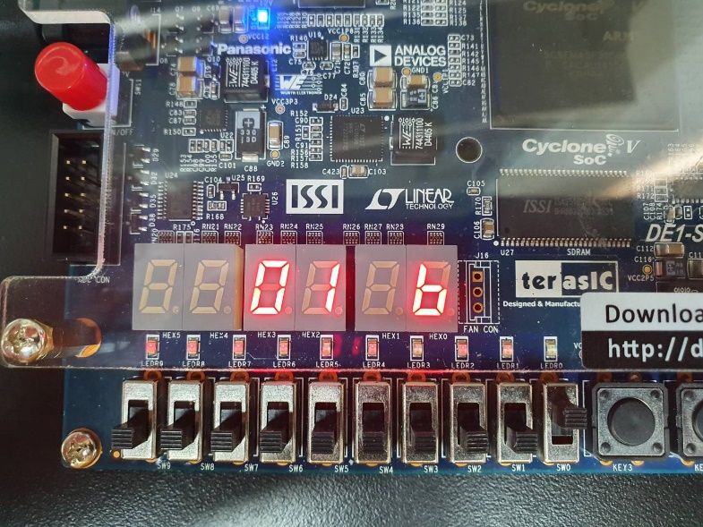
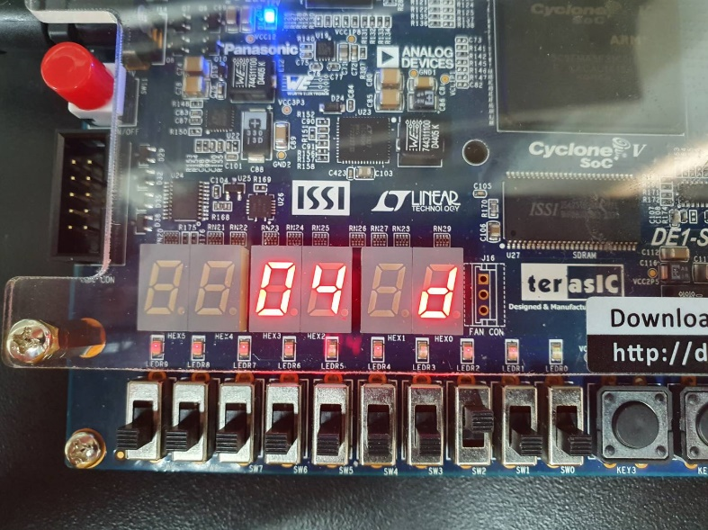
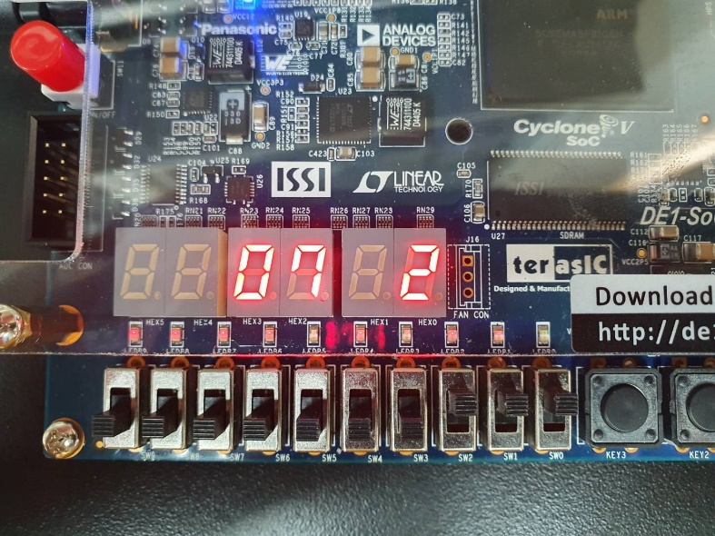
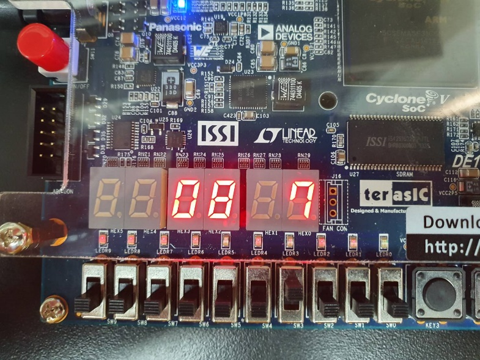
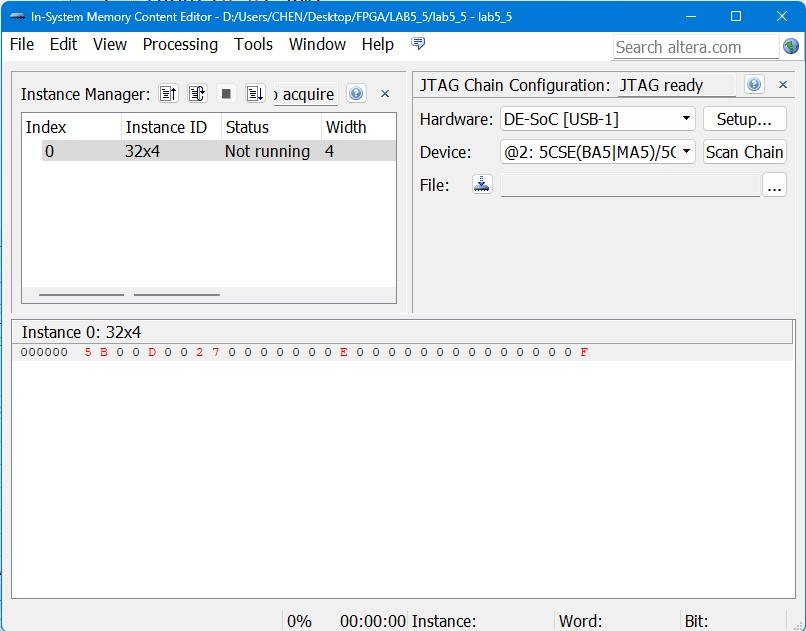
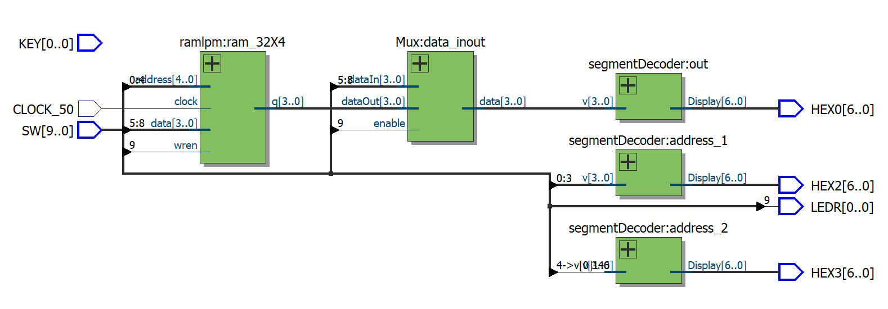

# Lab 5：FPGA RAM 與雙埠記憶體

[回到總覽](../../README.md) · [回到 Lab 索引](../../docs/LABS.md)

## 實驗目的

本實驗實作 32 x 4-bit RAM：5-bit address 可選擇 32 個位置，每個位置保存 4-bit data。內容涵蓋 Quartus LPM 記憶體、以 Verilog 推導 RAM、真正的 dual-port RAM，以及用 single-port RAM 配合 multiplexer 模擬讀寫操作。

## 子專案

| 專案 | 主要內容 | 重要模組／檔案 |
| --- | --- | --- |
| [`part01-lpm-single-port-ram`](projects/part01-lpm-single-port-ram/) | Quartus LPM single-port RAM | `ramlpm.v`, `ramlpm.qip` |
| [`part02-inferred-ram`](projects/part02-inferred-ram/) | 以 Verilog array 推導 RAM | `ram` |
| [`part04-dual-port-ram`](projects/part04-dual-port-ram/) | LPM dual-port RAM，自動遞增 read address | `ram_2port.v`, `ram_2port.qip`, `delay_1s` |
| [`part05-single-port-ram-mux`](projects/part05-single-port-ram-mux/) | single-port RAM 加 MUX 形成讀／寫介面 | `ramlpm`, `Mux` |

## 主要介面

- `SW[4:0]`：5-bit address。
- `SW[8:5]`：4-bit write data。
- `SW[9]`：write enable。
- `KEY[0]` 或 `CLOCK_50`：記憶體 clock，依子專案而定。
- `HEX0`：目前資料。
- `HEX2`、`HEX3`：address。
- `LEDR[0]`：write enable 狀態。

## 關鍵觀念

- FPGA block RAM 通常是同步寫入，讀取是否同步則取決於 IP 設定。
- Single-port RAM 同一時間共用一組 address；dual-port RAM 可分開提供 read/write address。
- LPM/QIP 檔描述 Intel FPGA IP，GitHub 上應保留設定來源，但不必保留所有生成資料庫。
- 寫入後立即讀取同一地址時，輸出可能是 old data、new data 或 don't care，需以 IP 設定為準。

## 實驗內容分析

LAB5_5 的實體記憶體仍是單埠 `ramlpm`，只有一組 `address`。`SW[9]=1` 時，RAM 持續把 `SW[8:5]` 寫入 `SW[4:0]` 指定的位置，同時顯示 MUX 直接把輸入資料送到 `HEX0`；`SW[9]=0` 時停止寫入，MUX 改顯示 RAM 的 `q`。

因此這個設計的重點是「以一個 port 分時完成寫入與讀回」，不是具備獨立 read address 和 write address 的真正 dual-port memory。真正的 dual-port 版本在 LAB5_4，介面中同時有 `rdaddress` 與 `wraddress`。

## 報告結果與解讀

| Address | 寫入／讀回資料 |
| --- | --- |
| `00` | `5` |
| `01` | `B` |
| `04` | `D` |
| `07` | `2` |
| `08` | `7` |
| `10` | `E` |
| `1F` | `F` |

這組資料刻意涵蓋最低地址、最高地址、低半部與高半部，並使用不同 4-bit pattern。成功讀回表示 5-bit address decoder 可覆蓋 32 個位置，4-bit data path 與 write-enable 也能正確工作。

## 實機結果與圖集

七張板端照片逐一對應上表地址／資料，另有一張 Quartus Programmer 畫面與一張 RTL Viewer。板端照片只有在 write enable 關閉後讀回相同值，才能作為記憶體保存成功的證據；寫入模式顯示的 input 本身不算 read-back。

| 低位地址 `00 → 5` | 中段地址 `10 → E` | 最高地址 `1F → F` |
| --- | --- | --- |
|  |  |  |

完整原始圖集（7 張板端照片、Programmer 與 RTL Viewer）

## 用途與延伸

- 小型 lookup table、buffer、register file 與暫存資料區。
- Dual-port RAM 可連接兩個不同處理單元，或同時進行讀與寫。
- FIFO、frame buffer 與 processor instruction/data memory。
- 用 `.mif` 預先載入常數，可實作 ROM 或查表運算。

## 限制與改進

- LAB5_5 不能同時使用兩個不同地址讀寫，因此不應稱為完整 dual-port replacement。
- `SW[9]` 保持為 1 時，每個 50 MHz clock 都會重複寫入；功能可行，但較好的 UI 是把按鍵邊緣轉成單週期 write enable。
- 開關直接進入同步邏輯，產品設計應加入 synchronizer／debounce。
- 顯示 MUX 在寫入模式呈現 data input，不代表已從 RAM read-back 驗證成功；驗證時必須關閉 write enable 再讀回。

## 驗證方式

1. 對地址 `0x00`、`0x01`、`0x04`、`0x07`、`0x08`、`0x10`、`0x1F` 寫入不同資料。
2. 關閉 write enable，再逐一讀回並與報告紀錄比對。
3. 對 dual-port RAM 同時改變 read/write address，確認兩個 port 的獨立性。
4. 重新上電後觀察未初始化 RAM 內容，區分模擬初值與硬體實際行為。

## 檔案入口

- [LPM RAM](projects/part01-lpm-single-port-ram/lab5_1.v)
- [Verilog RAM](projects/part02-inferred-ram/lab5_2.v)
- [Dual-port RAM](projects/part04-dual-port-ram/lab5_4.v)
- [Single-port 替代設計](projects/part05-single-port-ram-mux/lab5_5.v)
