# Lab 6：簡易處理器與指令記憶體

[回到總覽](../../README.md) · [回到 Lab 索引](../../docs/LABS.md)

## 實驗目的

本實驗建立一個簡易 8-bit processor。資料路徑包含 R0 到 R7 暫存器、A/G 暫存器、共用 bus、multiplexer、adder/subtractor 與 control unit；後續再加入 program counter 與 ROM，使處理器能依序取出並執行記憶體中的指令。

## 子專案

| 專案 | 主要內容 | 重要模組／檔案 |
| --- | --- | --- |
| [`part01-processor`](projects/part01-processor/) | 由開關輸入指令／資料的基本 processor | `processor`, `control_unit`, `mux` |
| [`part02-processor-rom`](projects/part02-processor-rom/) | 加入 program counter 與 instruction ROM | `programCounter`, `processor`, `controlUnit`, `myrom.v`, `lpmrom.mif` |

## 資料路徑

1. 指令或立即值由 `DIN`／ROM 送入處理器。
2. Control unit 依 instruction register 與目前 step 產生 register-in、register-out、A/G enable 與 add/sub 控制訊號。
3. Multiplexer 選擇一個來源放上 8-bit bus。
4. ALU 以 A register 與 bus 資料執行加法或減法，結果先存入 G。
5. G 再經 bus 寫回指定 general-purpose register。

## LAB6_2 外部介面

- `KEY[2]`：processor clock。
- `KEY[1]`：memory/program counter clock。
- `KEY[0]`：active-low reset。
- `LEDR`：顯示 bus 或處理狀態。
- `HEX0..HEX5`：顯示暫存器與目前 ROM 指令資料。

## 關鍵觀念

- Datapath 負責搬移與運算資料；control unit 負責在每個 timing step 啟用正確控制訊號。
- 一條算術指令通常需要多個 clock step：取 operand、運算、寫回。
- Program counter 提供 ROM address；ROM 內容由 `lpmrom.mif` 初始化。
- 共用 bus 同一時間只能有一個有效來源，否則會產生衝突或錯誤資料。

## 指令格式與控制流程

8-bit instruction 的 `IR[7:6]` 是 opcode，`IR[5:3]` 是目的 register `Rx`，`IR[2:0]` 是來源 register `Ry`。

| Opcode | 功能 | 執行週期 |
| --- | --- | --- |
| `00` | `mv Rx, Ry` | 讀 Ry 並寫入 Rx |
| `01` | `mvi Rx, immediate` | 下一個 memory word 經 DIN 寫入 Rx |
| `10` | `add Rx, Ry` | Rx→A、A+Ry→G、G→Rx |
| `11` | `sub Rx, Ry` | Rx→A、A−Ry→G、G→Rx |

Move 類指令在較少 step 內完成；add/sub 使用 A 與 G 暫存器，所以需要多個 clock step。`done` 讓 step counter 回到取指狀態。

## ROM 程式與預期結果

`lpmrom.mif` 前九個位置可解讀為：

| Address | 資料 | 解讀 |
| --- | --- | --- |
| 0–1 | `01000000`, `00000101` | `mvi R0, 5` |
| 2–3 | `01001000`, `00000111` | `mvi R1, 7` |
| 4 | `10000001` | `add R0, R1`，R0 變成 12 |
| 5–6 | `01010000`, `00000011` | `mvi R2, 3` |
| 7 | `00001010` | `mv R1, R2`，R1 變成 3 |
| 8 | `11000001` | `sub R0, R1`，R0 變成 9 |

因此完整執行後應觀察到 `R0=0x09`、`R1=0x03`。`HEX2/HEX3` 顯示 R0，`HEX0/HEX1` 顯示 R1；這是比只觀察 bus 更完整的結果判斷。

## 結果分析

報告結果圖沒有留下可抽取的數值說明，但 source 與 ROM 已能推導上述終值。報告討論提到 pipeline 與 read-after-write hazard；然而目前 HDL 是由 step counter 依序完成一條指令的 multi-cycle processor，同一時間沒有多條指令重疊執行，因此它不是 pipeline，也不會以典型 pipeline 方式產生 RAW hazard。

真正要注意的是 memory clock 與 processor clock 分開由 `KEY[1]`、`KEY[2]` 控制。若操作順序不正確，PC 可能先移到下一個 word，造成 instruction/immediate 和 processor step 不同步。

## 實機結果與圖集

十九張照片保存手動 clock 下的指令、bus 與 register 顯示狀態，RTL Viewer 則顯示 `programCounter → myrom → processor → segmentDecoder` 的頂層資料流。照片可證明當時能逐步操作與顯示狀態，但畫面本身無法取代逐 cycle 的自動化 assertion；`R0=0x09`、`R1=0x03` 是由 ROM 指令內容與 HDL 行為推導的預期終值。

| Reset／初始顯示 | 執行中狀態 | 程式尾端狀態 |
| --- | --- | --- |
| 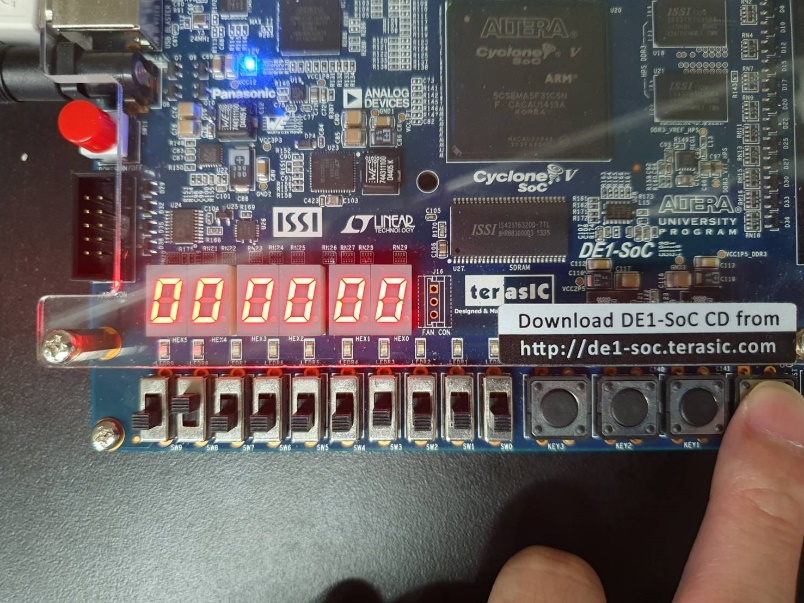 | 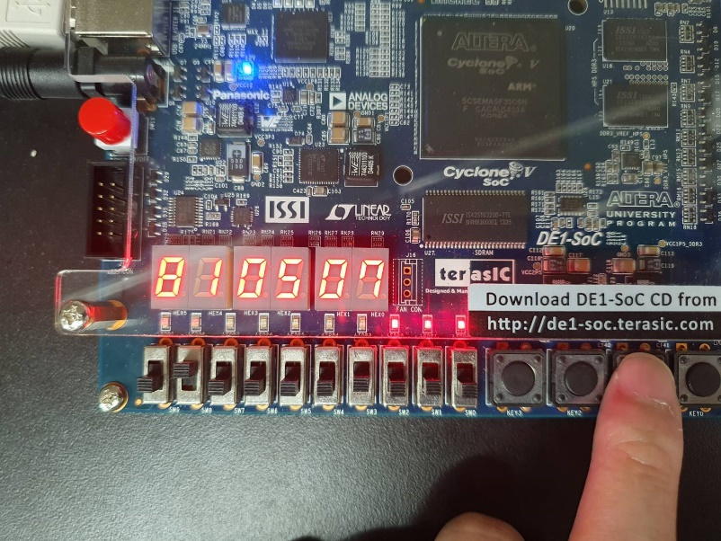 | 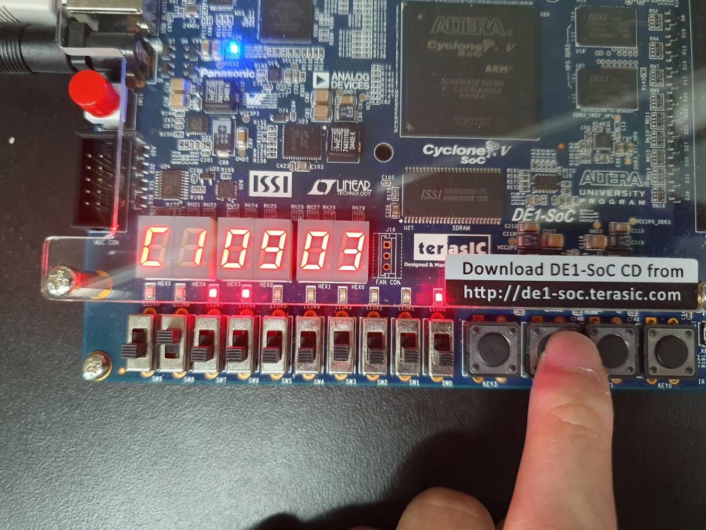 |

完整原始圖集（19 張實機照片與 1 張 RTL Viewer）

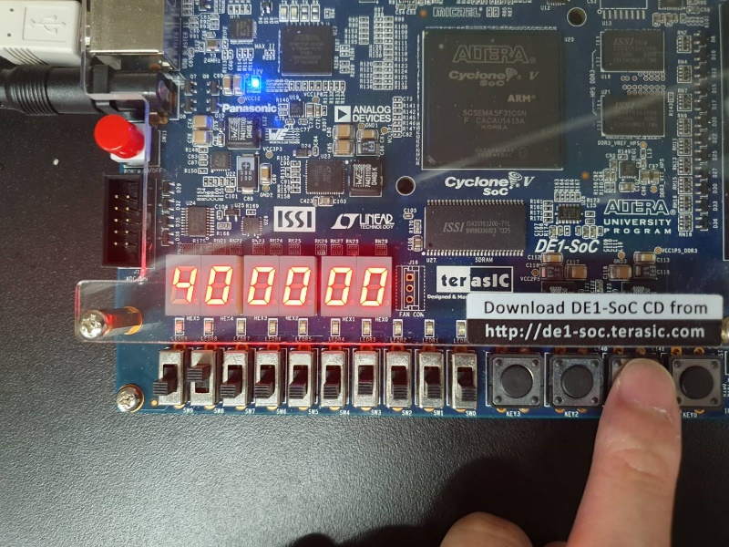
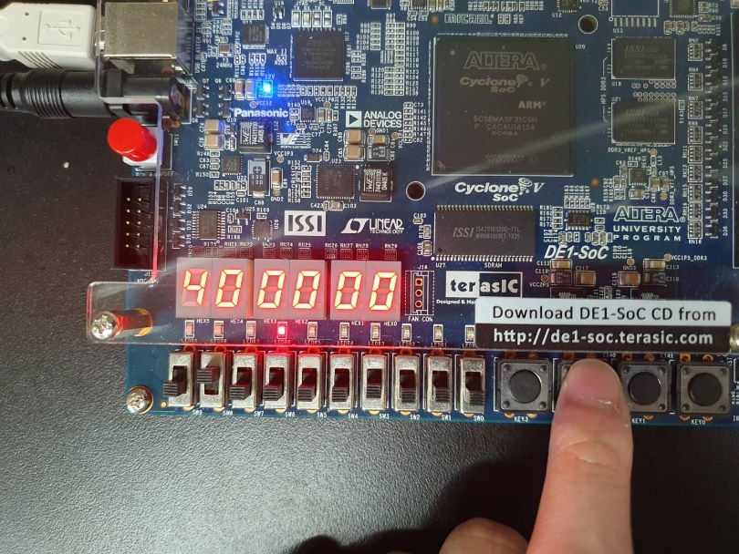
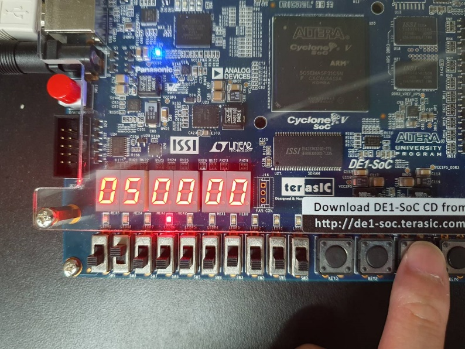
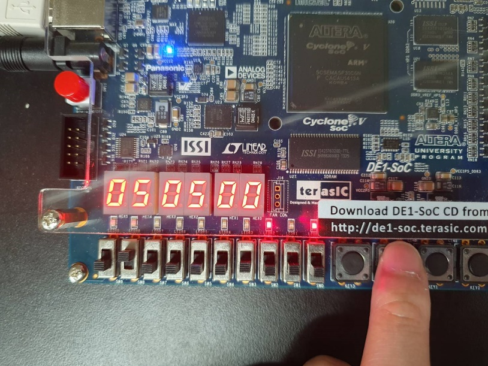
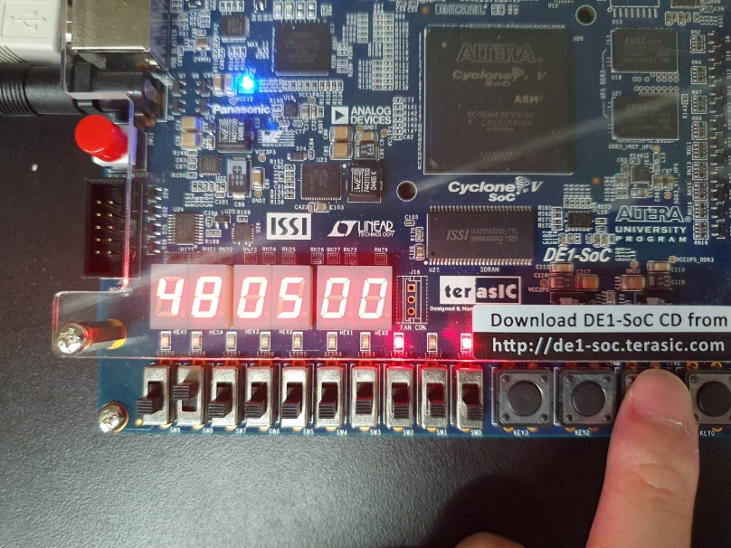
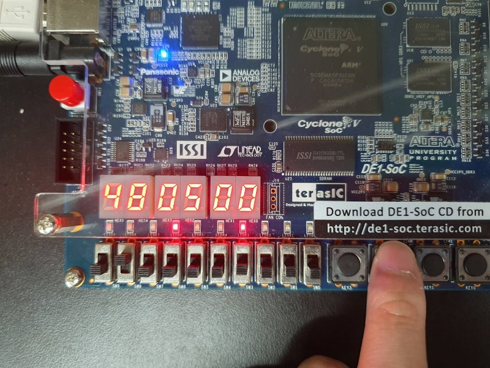
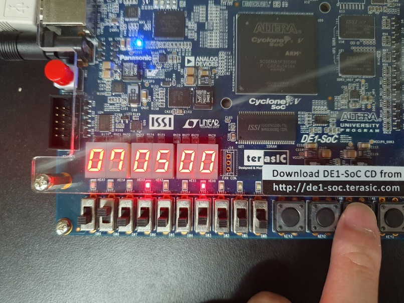
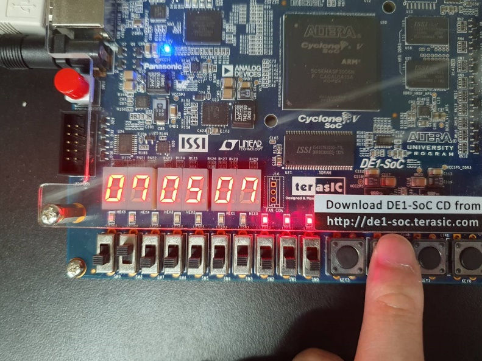

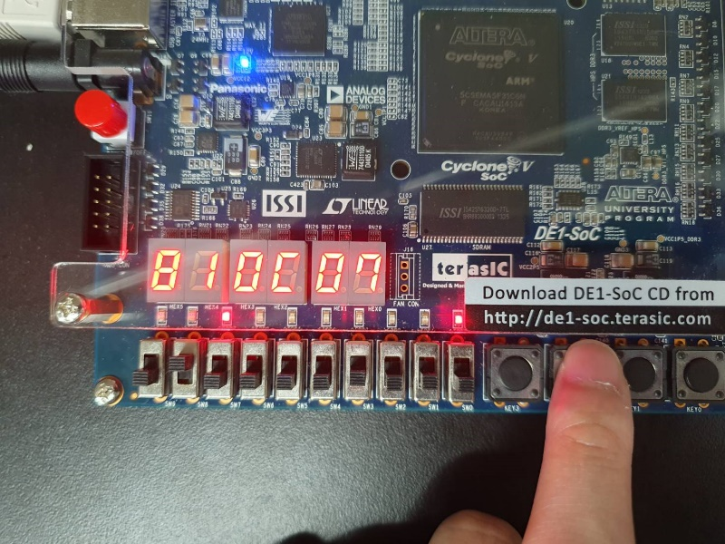
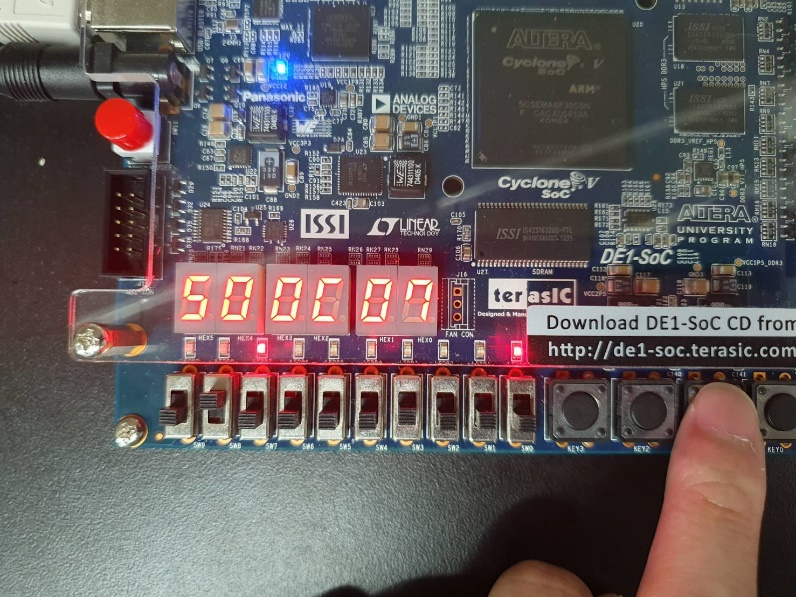
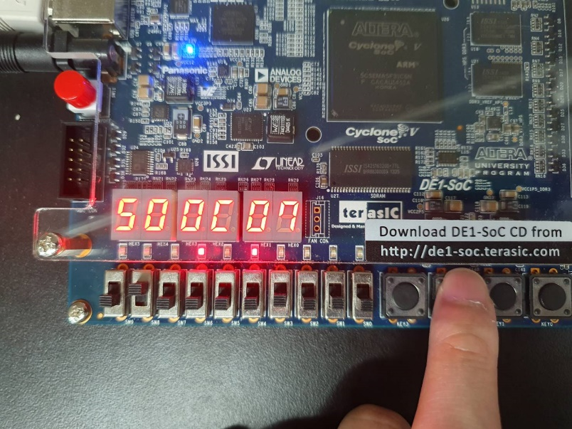
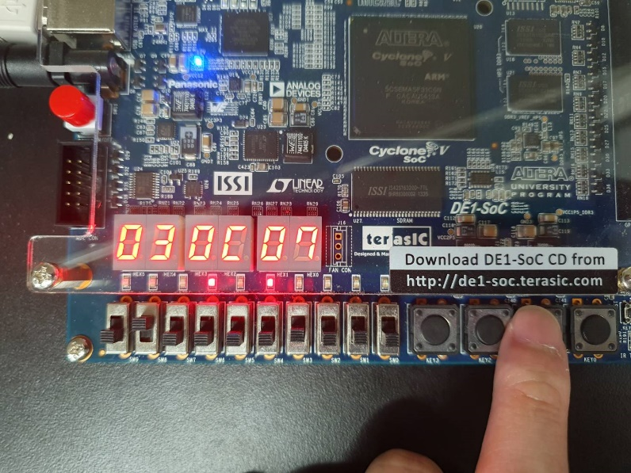
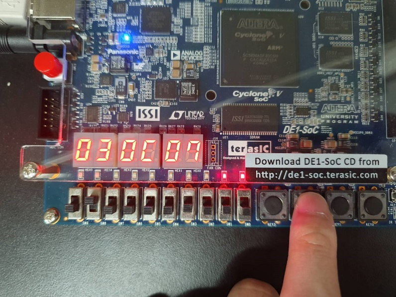
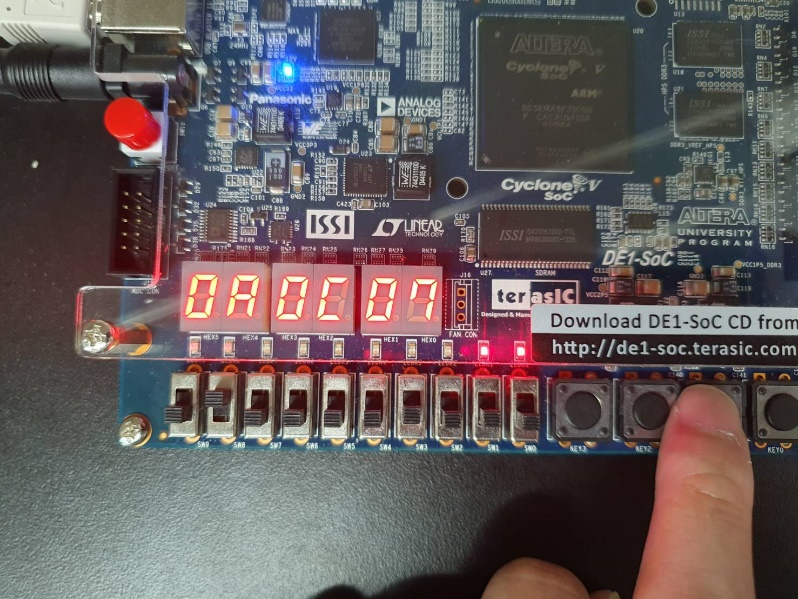
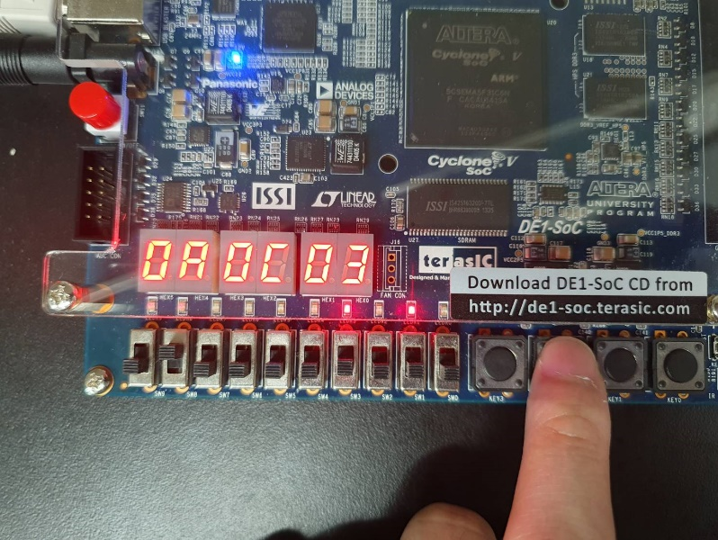
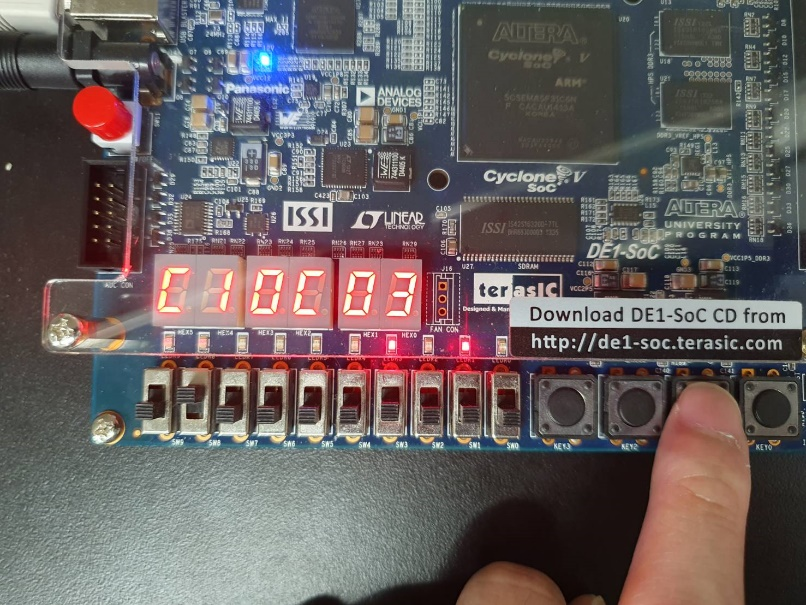

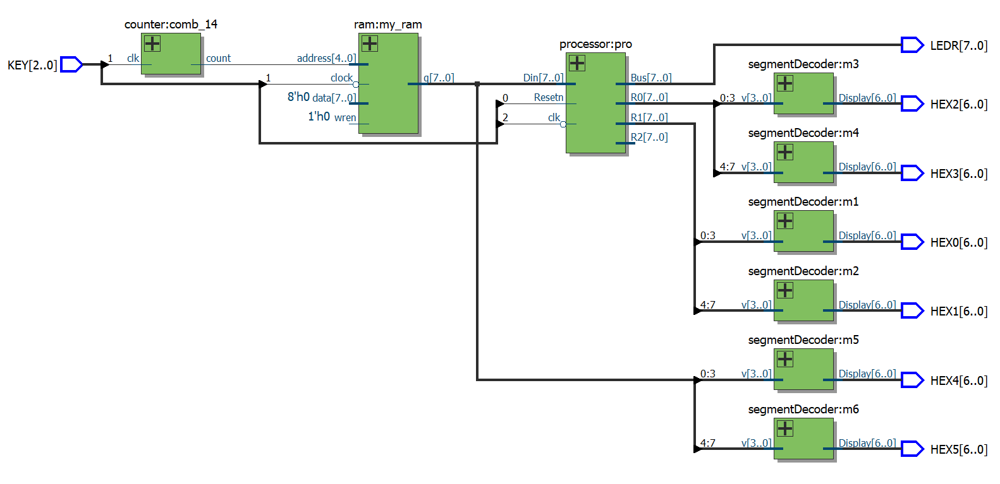

## 用途與延伸

- 理解 CPU datapath、control path、instruction encoding 與 micro-operation。
- 延伸 branch、compare、load/store、立即數與 condition flags。
- 合併成單一系統 clock，透過 enable 控制 PC 與 processor step。
- 加入 testbench，自動檢查每條指令後的 register state。

## 限制與改進

- General-purpose registers 沒有 reset，初始值在模擬中可能為 `X`。
- 內部 bus 無來源時被設為 `Z`；FPGA 內部 tri-state 通常會被綜合成 mux，明確設為 `0` 較容易驗證。
- 使用兩個手動 clock 容易造成操作與 clock-domain 問題。
- 若要升級為 pipeline，需新增 pipeline registers、hazard detection、forwarding 與 branch handling，不能只提高 clock。

## 驗證方式

1. Reset 後確認 PC、bus 與主要暫存器歸零。
2. 逐步 clock，記錄每個 micro-step 的 bus、R0、R1 與 done。
3. 用簡短 ROM 程式測試 move、add、sub 等指令。
4. 比對 `lpmrom.mif` 指令順序與七段顯示器／LED 的執行結果。

## 檔案入口

- [基本處理器](projects/part01-processor/lab6_1.v)
- [含記憶體處理器](projects/part02-processor-rom/lab6_2.v)
- [ROM 初始化內容](projects/part02-processor-rom/lpmrom.mif)
