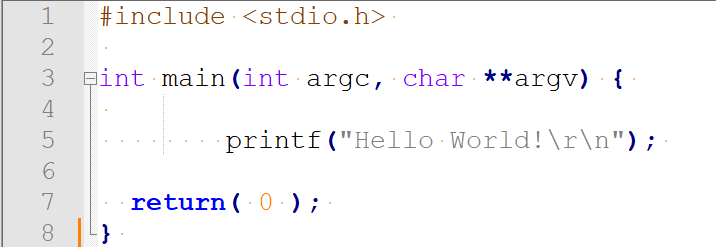
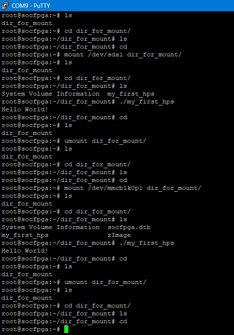

# Lab 7：DE1-SoC HPS 與 Linux

[回到總覽](../../README.md) · [回到 Lab 索引](../../docs/LABS.md)

## 實驗目的

本實驗認識 DE1-SoC 的 ARM-based Hard Processor System（HPS），練習連線到板上的 Linux 系統、建置程式並載入執行。HPS 包含 ARM processor、周邊與記憶體介面，並透過高頻寬 interconnect 與 FPGA fabric 連接。

## 報告可確認的流程

1. 建立主機與 DE1-SoC Linux 的連線。
2. 準備 C source、header、library 與 Makefile。
3. 使用 Makefile 編譯完整執行檔。
4. 把程式傳送到板端 Linux。
5. 在 HPS 上執行並觀察結果。

本 repository 的 Lab 8 Makefile 使用 `arm-linux-gnueabihf-` cross compiler 與 SoC EDS 的 `SOCEDS_DEST_ROOT` include path，可作為相同 HPS 平台的建置參考；它不是 Lab 7 當年的完整建置紀錄。Lab 7 保留的 source 截圖與 console 顯示範例程式及執行結果，未保存 compiler log。

概念上的建置流程為：

```text
main.c
  -> ARM cross compiler
  -> ARM executable (my_first_hps)
  -> copy/mount to DE1-SoC Linux
  -> ./my_first_hps
  -> Hello World!
```

## 核心觀念

- DE1-SoC 同時包含 ARM HPS 與 Cyclone V FPGA fabric。
- HPS 程式是 Linux 使用者空間程式，不是 Verilog 邏輯。
- Makefile 記錄 compiler、include path、library 與輸出檔規則。
- 與 FPGA 周邊溝通時通常需要 bridge address、memory mapping 與硬體產生的 header。

## 實驗內容

報告中的範例程式只有 `printf("Hello World!\r\n")`，目的是先確認 HPS 的完整軟體流程，而不是直接驗證 FPGA 周邊。結果畫面透過 PuTTY 連線到板端 shell，掛載可移除儲存裝置後進入目錄並執行 `./my_first_hps`。

畫面中可辨識兩種掛載來源：`/dev/sda1` 與 `/dev/mmcblk0p1`；目錄內也出現 `socfpga.dtb`、`zImage` 與執行檔，代表板端使用 Linux kernel、device tree 與使用者程式的典型 SoC 啟動／部署環境。

## 實驗結果與解讀

終端機成功印出 `Hello World!`，證明下列鏈結都已成立：

1. 主機能透過 serial terminal 連到 DE1-SoC。
2. Linux 能辨識並掛載儲存裝置。
3. HPS 執行檔格式與 ARM 平台相容。
4. 程式具有執行權限，動態／靜態函式庫需求可被滿足。
5. Linux userspace 能正常啟動程式並輸出到 console。

這個結果只驗證 HPS/Linux toolchain 與部署流程，尚未證明 HPS-to-FPGA bridge 或 FPGA peripheral 可存取；後者是 Lab 8 的驗證目標。

## 實機結果與圖集

| Hello World source | DE1-SoC Linux console |
| --- | --- |
|  |  |

左圖只證明範例程式內容；右圖才是板端證據，可辨識掛載裝置、目錄切換、執行檔啟動與 `Hello World!` 輸出。由於報告沒有保存完整 Makefile 與 compiler log，因此 cross-compilation 命令仍屬文件缺口。

## 用途與延伸

- 嵌入式 Linux 應用部署與板端除錯。
- 將演算法、網路、檔案系統與 UI 放在 ARM，硬體加速放在 FPGA。
- 後續可加入 cross-compilation、SSH/SCP、自動部署 script 與 systemd service。
- 可用 `/sys`、UIO 或 kernel driver 取代直接 `/dev/mem`，建立較安全的硬體介面。

## 限制與改進

- 報告未保存完整 Makefile、compiler 命令、傳檔方式與 Linux image 版本。
- 只以 Hello World 驗證執行環境，尚未測量效能或周邊功能。
- 正式文件應記錄 serial baud rate、登入方式、mount point 與 executable architecture。

## 建議記錄的操作資訊

若要讓 GitHub 讀者能重現，後續應補上：

- 使用的 Linux image／版本。
- 板子的 IP、SSH 或 serial 連線方式。
- 使用的交叉編譯器與環境設定。
- 實際 `make`、傳檔與執行命令。
- 程式執行結果截圖。

## 已知缺口

目前 workspace 沒有可明確獨立歸屬於 Lab 7 的 source folder。`../lab08/software` 包含相似的 HPS C/Makefile 結構，但它的 `main.c` 與 Lab 8 報告完全對應，因此本文件不把它重複標成 Lab 7 原始碼。
