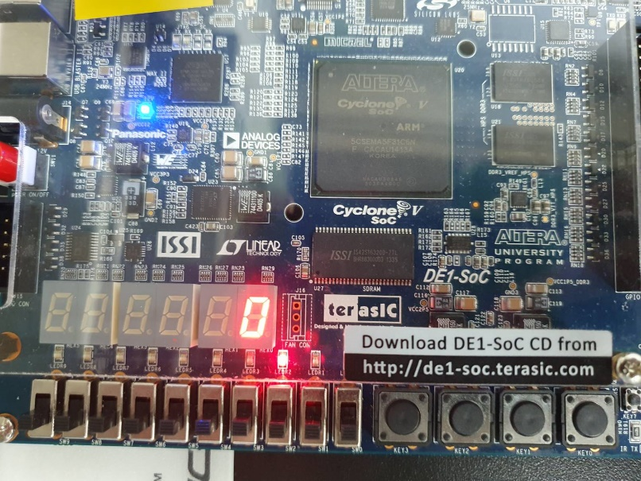
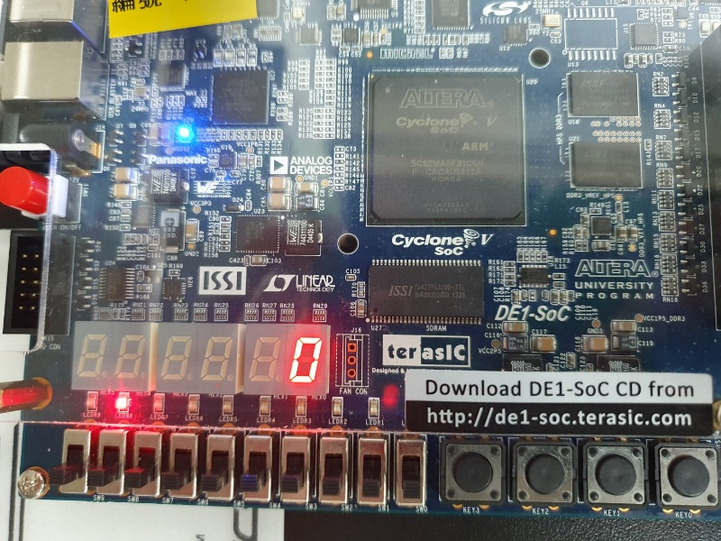
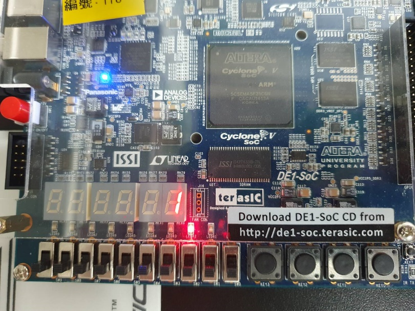

# Lab 8：Qsys HPS-FPGA 整合

[回到總覽](../../README.md) · [回到 Lab 索引](../../docs/LABS.md)

## 實驗目的

本實驗使用 Qsys（現稱 Platform Designer）連接 DE1-SoC 的 ARM HPS 與 FPGA fabric。FPGA 端提供 LED PIO 與七段顯示器元件，HPS 上的 Linux C 程式透過 lightweight HPS-to-FPGA bridge 存取這些 memory-mapped peripherals。

## 專案結構

| 路徑 | 角色 | 重要檔案 |
| --- | --- | --- |
| [`hardware`](hardware/) | Quartus/Qsys 硬體平台 | `soc_system.qsys`, `soc_system.qpf`, `soc_system.qsf`, `ghrd_top.v`, `SEG7_LUT.v` |
| [`software`](software/) | HPS Linux 使用者程式 | `main.c`, `hps_0.h`, `Makefile` |

## 硬體資料流

```text
ARM HPS/Linux
    |
    | lightweight HPS-to-FPGA bridge
    v
Qsys address space
    |-- pio_led ------> FPGA LEDs
    `-- SEG7_LUT_0 ---> seven-segment display
```

`soc_system.qsys` 內可辨識 `hps_0`、`pio_led` 與 `SEG7_LUT_0`。`ghrd_top.v` 是 FPGA top-level，負責連接 HPS I/O、clock/reset 與板上周邊。

## 軟體流程

`main.c` 先開啟 `/dev/mem`，再以 `mmap()` 映射 HPS register span。程式使用 `ALT_LWFPGASLVS_OFST` 加上 Qsys 產生的 `PIO_LED_BASE`、`SEG7_LUT_0_BASE` 算出虛擬地址，然後：

1. 讓 LED bit pattern 左右移動。
2. 把 loop counter 寫入七段顯示器元件。
3. 重複 60 回合。
4. 呼叫 `munmap()` 並關閉 `/dev/mem`。

## 實驗結果與解讀

報告的三張實機照片顯示：

- 七段顯示器右側數字先顯示 `0`，之後變成 `1`。
- 紅色 LED 以 one-hot pattern 在不同位置亮起。
- LED 與七段顯示器都由同一支 HPS C 程式控制。

這與 `main.c` 完全吻合：`led_mask` 從 `0x01` 開始，每次左移直到最高 LED，再反向右移；回到最低位時 `loop_count++`。七段顯示器顯示的是 round-trip 次數，不是目前 LED 位置，所以 LED 移動一個完整往返後數字才增加。

程式每個 LED pattern 先 `usleep(100*1000)`，接著又 `usleep(1000*1000)`，因此每步實際約等待 1.1 秒。原始註解寫「wait 100ms」並不符合總等待時間；這也解釋了實機觀察時 LED 移動較慢。

## 實機結果與圖集

三張照片記錄不同 one-hot LED 位置與七段顯示值。前兩張顯示 loop count 為 `0` 時 LED 在不同位置，第三張顯示完整往返後 loop count 增加為 `1`。這與 `main.c` 只有在 LED 回到最低位時才遞增 counter 的控制流程一致。

| LED 起始位置，count 0 | LED 移動中，count 0 | 完整往返後，count 1 |
| --- | --- | --- |
|  |  |  |

這組照片加上軟體 source 可支持 HPS 經 lightweight bridge 寫入 FPGA PIO；但本次整理沒有重新產生 Qsys、重新編譯 SOF 或再次上板執行。

## 分層分析

| 層級 | 責任 | 成功結果代表的意義 |
| --- | --- | --- |
| Qsys | 配置 HPS、bridge、PIO 與 address map | 軟硬體對同一 peripheral address 有一致定義 |
| Verilog | 連接 Qsys system、LED、七段顯示器與板上腳位 | FPGA fabric 能把 Avalon peripheral 輸出送到實體裝置 |
| Linux/HPS | 開啟 `/dev/mem`、mmap、寫入 register | ARM 能經 lightweight bridge 控制 FPGA |
| 實機輸出 | LED 移動、七段數字增加 | 整條 HPS-to-FPGA data path 已打通 |

## 實際用途

- ARM 負責複雜控制、網路與檔案系統，FPGA 負責低延遲 I/O 或硬體加速。
- Memory-mapped register 可用於 motor control、sensor interface、影像處理參數與 accelerator command/status。
- 七段顯示與 LED 是容易觀察的驗證周邊；同一方法可換成 PWM、ADC、camera 或自訂 IP。

## 建置與執行概念

1. 用 Quartus 開啟 `soc_system.qpf`。
2. 在 Platform Designer 檢查 `soc_system.qsys` 的元件與 address map。
3. 產生 HDL、編譯 Quartus project 並燒錄 FPGA。
4. 確認 `hps_0.h` 與目前 Qsys address map 一致。
5. 在正確的 SoC EDS／交叉編譯環境執行 `make`。
6. 將執行檔傳到 DE1-SoC Linux，使用足以存取 `/dev/mem` 的權限執行。

## 關鍵觀念

- Qsys peripheral 的 base address 是軟硬體契約；硬體重新配置後必須重新產生 header。
- `/dev/mem` 允許直接存取實體位址，通常需要 root 權限，也應限制映射範圍。
- `volatile` memory-mapped I/O 存取可避免 compiler 移除或重排必要的硬體讀寫；原始程式以指標轉型寫入，後續可再強化型別。
- Qsys 生成的 `synthesis/` 內容可以再生，核心來源是 `.qsys`、top-level、constraints 與自訂元件。

## 限制與改進

- `/dev/mem` 需要高權限且可能映射過大範圍；正式系統較適合 UIO 或 kernel driver。
- 對 memory-mapped register 的指標應宣告為 `volatile uint32_t *`，避免 compiler 最佳化硬體存取。
- 對 `void *` 做位址加法是 GNU extension；可先轉成 `uintptr_t` 或 `uint8_t *`，提高可攜性。
- `hps_0.h` 必須由目前的 `.sopcinfo` 重新產生，否則 base address 改變後軟體仍會寫到舊位置。
- 兩段 `usleep()` 可合併或參數化，讓註解與實際速度一致。

## 驗證方式

1. 確認 LED 光點能往返移動。
2. 確認七段顯示器隨 loop count 改變。
3. 若 `/dev/mem` 開啟失敗，檢查權限。
4. 若程式可執行但硬體無反應，優先比對 `hps_0.h` 與 Qsys address map。
5. 若 Quartus 編譯失敗，檢查 Qsys 生成檔與 HPS handoff 是否和目前版本相容。

## 檔案入口

- [Qsys 系統](hardware/soc_system.qsys)
- [FPGA top-level](hardware/ghrd_top.v)
- [HPS 程式](software/main.c)
- [Makefile](software/Makefile)
